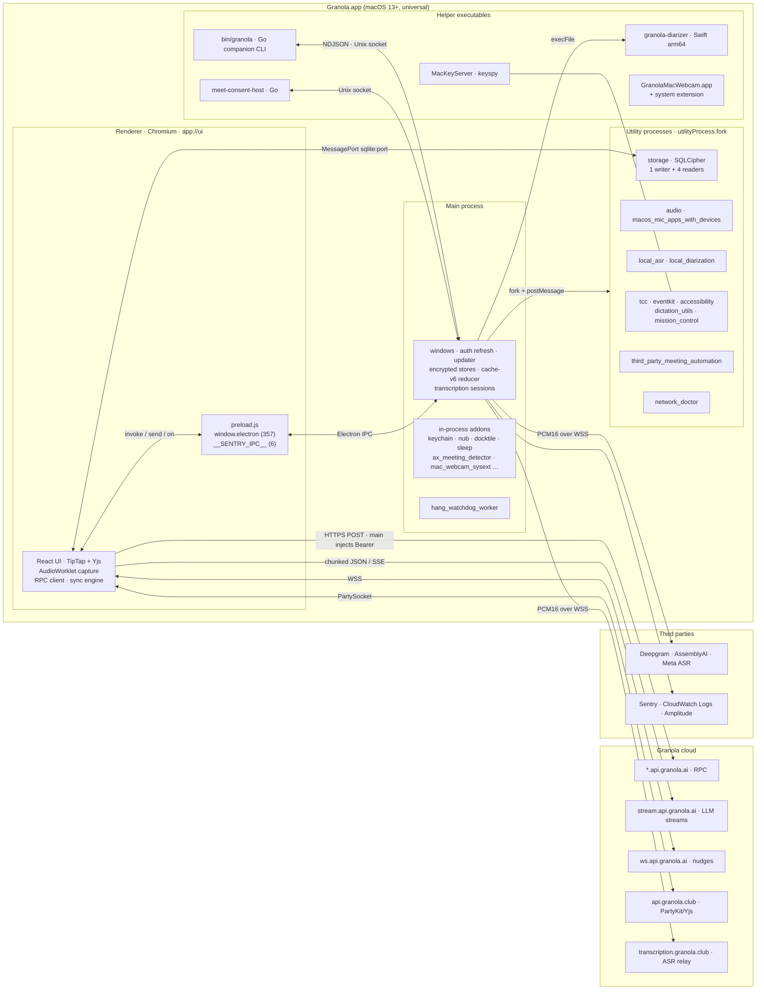

# 01 · Architecture: processes, bridge, native code, API, storage and sync

This page is the map of Granola desktop **7.663.2** (`com.granola.app`, macOS universal build): how the app is packaged, which processes run and how they talk, what the preload bridge exposes, which native modules and helper executables ship, how the backend API and auth work, where data is stored locally, how it syncs, and what the main records look like. The two deep dives build on it: [02 · Transcription](02-transcription.md) and [03 · AI enhancement](03-ai-enhancement.md). [00 · Method](00-method.md) explains how the analysis was done.

Everything here comes from static reading of the signed bundle and its extracted `app.asar`. No Granola code was executed and nothing was sent to Granola's API.

## Conventions

- **Tags.** **(Observed)**: literally in the bundle at the cited spot. **(Inferred)**: reasoned from observed facts. **(Unknown)**: not answerable from the client, usually because it happens on the server.
- **Evidence** looks like `main/index.js@481617`: a file inside `app.asar` plus a **character offset**, the 0-based JavaScript string index (UTF-16 code units) that `indexOf` returns for the cited literal. Paths under `dist-electron/` are abbreviated (`main/index.js`, `preload/preload.js`, `main/logs-transport-0BuDxWnM.js`, `sqlite_process/worker.js`, `<name>_process/index.js`). Renderer chunks under `dist-app/assets/` are cited by file name (e.g. `api-CCQ12bLQ.js`). `main/index.js` and `primary-RB5K54tJ.js` contain non-ASCII text, so their UTF-8 byte offsets are higher than the cited character offsets. Bundle-level paths read `Contents/...` (inside `Granola.app`), and native evidence reads `binary: "string"`.
- **No Granola code** is reproduced: only identifiers, field names, endpoint paths, flag names, hosts and constants. **No secrets**: pool IDs, DSNs and tokens are shown as `<redacted>`.

## TL;DR

- **A large but conventional Electron 44 app.** One main process (6.9 MB bundle), a React renderer served from a privileged `app://ui` scheme, one preload that exposes a 357-member `window.electron` bridge, and **13 utility-process entry points** (12 used on macOS) started with `utilityProcess.fork`. Most of them wrap a single Swift/Objective-C N-API addon. **(Observed)**
- **Heavy native macOS integration.** `Contents/Resources/native/` holds 19 `.node` addons (audio tap, AX meeting detection, Zoom/Teams/Meet automation, EventKit, Keychain, TCC, virtual camera, …). Next to them ship Go and Swift helpers: a companion CLI, a Chrome native-messaging host and a CoreML diarizer. **(Observed)**
- **The backend is named-route JSON RPC.** A shared config map holds **503** route names spread over `api.granola.ai`, five "botanical" sub-hosts and `stream.api.granola.ai`. Every call is `POST` + JSON + bearer token, and desktop code references 323 of the routes **(Observed)**. The server side is most likely AWS API Gateway + Lambda **(Inferred)**.
- **Auth is PKCE in the system browser, brokered through WorkOS.** The browser hands back to the app through `granola://`. Tokens are kept in an AES-256-GCM file whose data key lives in the macOS Keychain, and main rewrites `Authorization` on renderer requests with a fresh token. **(Observed)**
- **Local state has two halves.** A SQLCipher `granola.db` (drizzle schema, 41 migrations, FTS5 trigram search) runs in its own process and is reached over a MessagePort. An encrypted reducer cache in main, `cache-v6.json.enc`, holds live transcripts, feature flags and the sync op-log. **(Observed)**
- **Sync has four layers.** (1) Set-diff pull of documents. (2) Entity op-log push (`sync-push`). (3) A "poke-then-pull" WebSocket on `ws.api.granola.ai`. (4) Yjs CRDT rooms over PartyKit on `api.granola.club`. **(Observed)**
- **Transcription happens in main.** It streams two mono 16 kHz PCM16 sources (mic and system) to Deepgram nova-3 by default, using short-lived vendor tokens that the backend mints. See [02](02-transcription.md). **(Observed)**
- **AI prompts live on the server.** The client sends `prompt_slug` + variables, and the result streams back as chunked JSON frames plus a Yjs document. See [03](03-ai-enhancement.md). **(Observed)**
- **Telemetry goes three ways.** Sentry runs in every process. Amplitude goes through a first-party proxy. CloudWatch Logs are written directly with unauthenticated Cognito credentials. **(Observed)**

## Architecture at a glance

**Granola-owned hosts** (all **Observed**; route counts come from the `api_urls` map):

| Host | Role | Evidence |
|---|---|---|
| `api.granola.ai` | Core RPC: 273 `/v1/` + 3 `/v2/` routes, including auth, update feed and `get-versions` | `main/logs-transport-0BuDxWnM.js@18704` |
| `maple.` / `cinnamon.` / `pecan.` / `chia.` / `berry.api.granola.ai` | Sharded RPC: 52 / 43 / 39 / 39 / 30 routes | same map |
| `stream.api.granola.ai` | 23 long-lived streaming routes (`generate-summary`, `chat-with-documents`, `llm-proxy-stream`, `read-durable-stream`, …) | same map |
| `wss://ws.api.granola.ai` | Realtime "nudge" socket (`websocket_url`) | `main/logs-transport-0BuDxWnM.js@58558` |
| `api.granola.club` | Cloudflare worker for collaboration (`cloudflare_worker_urls.collaboration`): PartyKit rooms | `main/logs-transport-0BuDxWnM.js@58730` |
| `wss://transcription.granola.club` | Cloudflare transcription relay | `main/index.js@5058031` |
| `logs.granola.ai` | `logs-proxy` (`/v1/logs`), an alternative log sink | `main/logs-transport-0BuDxWnM.js@101190` |
| `amp.granola.ai` | Amplitude HTTP API proxy (`/2/httpapi`) | `main/index.js@4632629` |
| `mcp.granola.ai`, `notes.granola.ai`, `recipes.granola.ai`, `meet.granola.ai`, `download.granola.ai` | MCP server for external agents, shared-note links, recipe links, heads-up page, release downloads | `primary-RB5K54tJ.js@1784349`, `visibilityDescription-D8WmKwSO.js@62234`, `constants-CD0tZHlZ.js@4094`, `primary-RB5K54tJ.js@2835529`; `install-granola.sh` |
| `dr2v7l5emb758.cloudfront.net` | Update zips and on-device ASR models (Granola-operated, **Inferred**) | update feed; `main/local-asr-protocol-DX0Mkc-d.js@0` |

## 1. Distribution and packaging

| Fact | Value | Tag |
|---|---|---|
| Bundle id / version | `com.granola.app` / `7.663.2` (both `CFBundleShortVersionString` and `CFBundleVersion`) | Observed |
| Minimum macOS | `LSMinimumSystemVersion` 13.0; built with the macOS 15.5 SDK and Xcode 16.4 | Observed |
| Runtime | Electron Framework 44.4.2, universal (x86_64 + arm64); Squirrel, Mantle and ReactiveObjC frameworks | Observed |
| URL scheme | `granola` (`granola-dev` when unpackaged, `main/index.js@6820041`) | Observed |
| `package.json` | `@granola/electron`, main `dist-electron/main/index.js`, repo `granola-inc/granola-electron`. Runtime deps: `better-sqlite3-multiple-ciphers`, `keyspy`, `registry-js`, `win-ca`, `@napi-rs/xattr`, `electron-click-drag-plugin`, `@discoveryjs/json-ext`, `@mixmark-io/domino` | Observed |
| Layout | `dist-electron/main` (51 files: `index.js`, AWS SDK chunks, `hang_watchdog_worker.js`), `dist-electron/preload/preload.js`, 13 `*_process/` dirs, `dist-app/` (Vite/rolldown output: `index.html` + 300 JS chunks, React) | Observed |
| ATS | `NSAllowsArbitraryLoads` false; local networking and a `127.0.0.1` HTTP exception (the local whisper server, **Inferred**) | Observed |

**Updates.** The app uses `electron-updater` with a *generic* feed set to the `check-for-update` route, which resolves to `api.granola.ai/v1/check-for-update/latest-mac.yml`. The feed points at `dr2v7l5emb758.cloudfront.net/<ver>/Granola-<ver>-mac-universal.zip`. The updater sets auto-download when packaged, differential download off and downgrade off, and applies the update through Squirrel.Mac behind a localhost proxy (`main/index.js@6272299`, `@6256261`) **(Observed)**. `Contents/Resources/app-update.yml` still declares the GitHub provider `granola-inc/granola-electron`, but `setFeedURL` overrides it **(Inferred)**. MDM fleets get a separate path: a root-run `managed-update/install-granola.sh` downloads from `download.granola.ai` and verifies bundle id, Team ID, code signature and Gatekeeper. If Granola is running, the script asks it to quit through a handshake file `/private/var/run/granola-managed-update-request-<uid>`, which the app checks (`main/index.js@6302611`) **(Observed)**.

**Privacy usage strings** (`Info.plist`) **(Observed)**:

- Microphone; system audio (`NSAudioCaptureUsageDescription`); screen capture, which Granola says it uses "to transcribe system audio".
- Calendars; contacts, for dialling phone numbers.
- Camera, "to show a watermark in meetings".
- A system extension for the virtual camera; Bluetooth.

**Electron fuses** (REA `inspect-electron-fuses`, same result on both slices) **(Observed)**:

| Fuse | State | Note |
|---|---|---|
| `RunAsNode` | disabled | `ELECTRON_RUN_AS_NODE` is ignored (hardening) |
| `EnableNodeCliInspectArguments` | disabled | no `--inspect` attach (hardening) |
| `EnableEmbeddedAsarIntegrityValidation` | enabled | header hash checked against `Info.plist` `ElectronAsarIntegrity` (SHA256) |
| `OnlyLoadAppFromAsar` | enabled | no loose `app/` folder override |
| `EnableNodeOptionsEnvironmentVariable` | enabled | Electron default; `NODE_OPTIONS` is still honoured |
| `EnableCookieEncryption` | disabled | Electron default |
| `GrantFileProtocolExtraPrivileges` | enabled | Electron default |
| `LoadBrowserProcessSpecificV8Snapshot` / `WasmTrapHandlers` | disabled / enabled | Electron defaults |

**Integrity.** `app.asar` SHA-256 is `17046e95…1302b9`; the REA evidence id is `ev_237a71f8…d71068b` (full values in [00](00-method.md)). REA found 8 integrity contradictions, all on unpacked native `.node` files under `app.asar.unpacked/` **(Observed)**. This is expected: code signing rewrites those files after the archive header recorded their hashes **(Inferred)**.

**Renderer hardening.** All 17 `webPreferences` blocks that load the preload set `contextIsolation: true` and `nodeIntegration: false`, for example the primary window at `main/index.js@6821679`. None sets `sandbox` explicitly, so Electron's default applies **(Inferred)**. The primary window also enables `devTools`. The UI loads from the custom scheme `app://ui`, registered as standard, secure, fetch- and stream-capable, and served from `dist-app/` (`main/index.js@4702740`, `@4582687`) **(Observed)**. `index.html` carries a CSP meta tag, but only inside an HTML comment, and main contains no `Content-Security-Policy` string **(Observed)**. Whether any CSP is enforced is therefore **Unknown**.

## 2. Process model

Each process has one responsibility. Main owns windows, secrets, the token lifecycle, the reducer cache, transcription sockets and the updater. The renderer owns UI, notes editing, most RPC calls, document sync and collaboration. Utility processes isolate native code and heavy work, so an addon crash takes down only that process: main restarts the audio process up to 20 times, for example (`main/index.js@4732843`). All forks go through one wrapper around `utilityProcess.fork` (`main/index.js@4583667`), and Sentry proxies that function so it can attach to each child (`main/index.js@4439088`) **(Observed)**.

| `serviceName` | Entry | Native payload | Role | Evidence |
|---|---|---|---|---|
| `storage` | `sqlite_process/index.js` + `worker.js` | `better_sqlite3.node` (SQLCipher) | Encrypted `granola.db`; 1 writer and 4 read-only worker threads; MessagePorts to renderers | `main/index.js@6710984`, `sqlite_process/index.js@1471` |
| `audio` | `audio_process/index.js` | `macos_audio_capture.node` | Native capture manager. On macOS in this build capture actually runs in the renderer through Chromium (selector at `main/index.js@4741065`); see [02 §1](02-transcription.md) | `main/index.js@4729685` |
| `macos_mic_apps_with_devices` | `…/index.js` | `macos_mic_apps_with_devices.node`, `macos_audio_capture.node` | Lists apps that are using a mic (meeting detection) and input devices | `main/index.js@4636670` |
| `local_asr` | `local_asr_process/index.js` | downloaded sherpa-onnx / whisper-server | Opt-in on-device ASR | `main/index.js@5087712` |
| `local_diarization` | `local_diarization_process/index.js` | downloaded ONNX Runtime | Live speaker diarization (flag-gated) | `main/index.js@5119801` |
| `tcc` | `tcc_process/index.js` | `tcc.node` | One-shot TCC permission probes (`accessibility`, `system-audio`) | `main/index.js@4583835`, `tcc_process/index.js@556` |
| `eventkit` | `eventkit_process/index.js` | `eventkit.node` | macOS Calendar events (`refresh-events`) | `main/index.js@6292914` |
| `accessibility` | `accessibility_process/index.js` | `accessibility_tree.node` | AX-tree reader, handed to the renderer over `accessibility-tree:port` | `main/index.js@4586038` |
| `dictation_utils` | `dictation_utils_process/index.js` | `dictation_utils.node` + keyspy `MacKeyServer` | Global dictation: `listenForShortcut`, `pasteText`, `getScreenContext`, edit observation | `main/index.js@6859348`, `dictation_utils_process/index.js@7777` |
| `third_party_meeting_automation` | `…/index.js` | `third_party_meeting_automation.node` + bridge dylib | Zoom/Teams/Meet automation: `monitor-zoom-speakers`, `select-teams-camera`, `read-teams-meeting-id`, `run-electron-chatpaste`, … | `main/index.js@4678088`, `third_party_meeting_automation_process/index.js@828` |
| `mission_control` | `mission_control_process/index.js` | `mission_control.node` | Mission Control enter/exit events | `main/index.js@6622753` |
| `network_doctor` | `network_doctor_process/index.js` | none | Connectivity diagnostics on the default session | `main/index.js@6640555` |
| `mic_monitor_v2` | `mic_monitor_v2_process/index.js` | Windows `granola.native.windows…msvc.node` | Windows only; shipped but never started on macOS | `main/index.js@4651126`, `@4653387` |

Other execution contexts **(Observed)**:

- **Main worker thread.** `hang_watchdog_worker.js` runs as a `worker_threads` Worker with a `thresholdMs` watchdog for main-thread hangs (`main/index.js@6295545`).
- **Renderer windows.** 20 `BrowserWindow` constructions. Besides the primary window there are a mini/side window, the floating "nub" meeting widget, notification cards (hermes, dispatcher, reminder-agent, objections notch, active listening), overlays (accessibility, screen-recording guide, companion presence), a demo-meeting window and a webcam config window.
- **Chromium helpers.** The standard `Granola Helper (Renderer|GPU|Plugin).app` bundles. Chromium feature switches turn on system-audio loopback: `MacCatapSystemAudioLoopbackCapture` on macOS 14+ and `MacSckSystemAudioLoopbackOverride` on 13 (`main/index.js@6813510`).
- **Local servers.** A companion-CLI socket, `$TMPDIR/granola-companion-cli.sock`, speaks NDJSON with token auth (`main/index.js@6017982`; methods `notes.list`, `notes.get`, `notes.transcript.get`, `folders.*` at `@6021179`). A per-user meet-consent socket, `/tmp/granola-meet-consent-<hash>.sock`, serves the native-messaging host (`main/index.js@4795229`).

**IPC patterns** **(Observed)**:

1. Classic `ipcRenderer.invoke` / `send` / `on` with literal channel names in the preload.
2. **MessagePorts** for high-volume paths. The renderer asks with `send('sqlite:port')`; main creates a `MessageChannelMain`, posts one end to the storage process and the other to the frame (`main/index.js@6857899`); the preload re-posts it to the page with `window.postMessage` (`preload/preload.js@1012`). `dictation-utils:port` and `accessibility-tree:port` work the same way.
3. `process.parentPort` messages between main and each utility process.
4. Audio frames go renderer → main as `audio-capture-buffer` messages on `from-audio-process` (`main/index.js@4736081`).

## 3. Preload bridge

REA reports **2 contextBridge APIs, 362 exposed members and 1 resolved preload entry point**. It leaves most IPC channel names unresolved, because Sentry builds its channel names at runtime (`createKey` → `sentry.<name>`). Read literally, the preload gives this breakdown **(Observed)**:

| Namespace | Members | Breakdown | Evidence |
|---|---|---|---|
| `window.electron` | 357 | 130 `invoke`, 136 `send`, 83 `on` (returns an unsubscribe), 6 constants (`isWebShell:false`, `bridge{version:1, shellVersion, shellCommit}`, `platform`, `arch`, `osVersion`, a dev flag), 2 other | `preload/preload.js@1555` |
| `window.__SENTRY_IPC__` | 6 | `sendRendererStart`, `sendScope`, `sendEnvelope`, `sendStatus`, `sendStructuredLog`, `sendMetric` | `preload/preload.js@931` |

The two counts (357 + 6 vs. 362) differ by one; how REA counts members is **Unknown**. The bridge has **no generic HTTP proxy**: the renderer calls the API itself, and main only rewrites `Authorization` (§6). `isWebShell` and `bridge` exist because the same renderer bundle also ships as a web app **(Inferred)**.

Members grouped by concern. The groups come from name matching and are approximate. Channel names are given in parentheses for a few key members; most are a kebab-case or `namespace:verb` form of the member name.

| Group (≈count) | Members (names only) |
|---|---|
| Audio and transcription (34) | `setDesiredTranscriptionState` (`set-desired-transcription-state`), `awaitTranscriptionSessionStopped`, `onMeetingTranscriptionState`, `sendAudioProcessMessage` / `onAudioProcessMessage`, `onNativeSystemAudio`, `onAudioSystemState`, `getAudioCaptureStatus`, `restartAudioProcess`, `onAudioVolume`, `onActiveSpeaker`, `onMicSourceMutedChanged`, `getTranscriptionInputSelectionState`, `setTranscriptionInputPreference`, `onInputDevicesChanged`, `onActiveInputDeviceChanged`, `onSystemCaptureSourceChanged`, `requestMicrophonePermission`, `requestSystemAudioPermission`, `checkSystemAudioTccPermission`, `start/stopPowerSaveBlocker`, `getSilencedApps`, `onStopTranscriptionAndClose`, `onTranscriptionPolicyGroupMembershipPrefetchRequested` |
| On-device ASR, diarization, voice ID, encrypted audio (27) | `get/start/deleteLocalAsrDownload(State)`, `onLocalAsrDownloadStateChanged` (`local-asr:*`), `getDiarizationEmbeddingSnapshot`, `getDiarizationClusteringSnapshot`, `exportDiarizationFingerprints`, `loadDiarizationFingerprintExport`, `*VoiceFingerprint*` (status, enroll-from-WAV, save/list/read/compare/diarize samples, relabel document), `open/append/close/read/remove/clearEncryptedFile(s)` |
| Meeting detection, consent, calendar (≈47) | `getMeetConsentStatus`, `setMeetConsentEnabled`, `startCoordinatedMeetConsentSend`, `onMeetConsentChatStatus`, `onMeetCallState`, `get{Meet,Zoom,Teams,MeetChrome}AttributionSessionStats`, `trigger{Meet,Zoom,Teams}CameraSwitch`, `onBrowserExtensionMeetingEnded`, `getPresenceMeetingId`, `isZoomLobby`, `getEventKitEvents`, `getEventKitCalendars`, `requestEventKitAccess`, `joinEventCall`, `setTrayCalendarEvents`, demo-meeting and companion-presence-overlay members |
| AI surfaces, UI side (≈73) | `submitQuickChat` / `onQuickChatMessage`, `requestCompanionNotes`, `takeInteractiveScreenshot`, `start/stopChatPaste`, `*ScreenShareContext*` (capture and review), `getScreenContextDetection`, `*Nub*` (floating widget, `createNubDocument`, `addNubScreenshotAttachment`), notification cards `*Hermes*`, `*Dispatcher*`, `*ReminderAgent*`, `*ObjectionsNotch*`, `*ActiveListening*`, `setNotificationBriefPanelOpen` |
| Documents and storage (16) | `getCache` (`cache:get`), `dispatchCache` (`cache:dispatch`), `onCacheCommitted` (`cache:committed`), `getCacheFileSize`, `updateCacheStats`, `getInitialPreferences`, `setPreferences`, `requestSqlitePort` (`sqlite:port`), `requestDictationUtilsPort`, `requestAccessibilityTreePort`, `get/install/removeCompanionCliSkill`, `writeClipboardText` |
| Auth and session (16) | `getSession`, `getRefreshedAccessToken`, `setTokens` (`set-tokens`), `setUserInfo`, `logout`, `onSessionChanged`, `onClearUserData`, `getStoredAccounts`, `switchToAccount`, `getDeviceId`, `getManagedAuthPolicy`, `authenticateDeviceOwner`, `getPendingDeepLinkUrl`, `onGranolaUrlReceived` |
| Virtual camera / webcam (≈51), telemetry (≈14), windows and system (rest) | `installWebcamExtension`, `startWebcamModule`, `checkWebcamHealth`, …; `trackAmplitudeEvent`, `logAmplitudeEvent`, `runNetworkDoctor`, `getNetworkInterception`, `logProcessStats`; window placement, sleep/wake, Mission Control, permissions and settings openers, updater |

The renderer does none of the transcription or LLM work through this bridge. Audio frames go up through `sendAudioProcessMessage`. Transcript chunks come back as `cache:committed` transactions. LLM calls are plain HTTP from the renderer.

## 4. Native modules and helper binaries

Native addons live in `Contents/Resources/native/` and are resolved through a single path helper. Most fall back to a no-op stub, and log a `*-native-load-failed` event, if loading fails **(Observed)**.

| Module | Loaded in | Purpose | Tag | Evidence |
|---|---|---|---|---|
| `macos_audio_capture.node` | `audio` / mic-apps process | Core Audio process tap + ScreenCaptureKit fallback, AUHAL mic, bundled WebRTC AEC3; device enumeration. Capture through it is dormant on macOS in this build | Observed ([02 §1.6](02-transcription.md)) | `main/index.js@4633230` |
| `ax_meeting_detector.node` | main | Accessibility-API meeting detection (Meet/Teams/Zoom URLs and window titles) | Observed | `main/index.js@4742985` |
| `macos_mic_apps_with_devices.node` | utility | Which processes hold mic input (Core Audio process objects) | Observed | `main/index.js@4633187` |
| `third_party_meeting_automation.node` + `libThirdPartyMeetingAutomationBridge.dylib` (10.5 MB) | utility | Drives Zoom/Teams/Meet UIs: speaker monitoring, camera selection, meeting id and participant reads, chat paste | Observed (message cases); dylib role Inferred | `main/index.js@4662404` |
| `dictation_utils.node` | utility | Dictation helpers: shortcut listening, paste into the focused app, screen context | Observed | `main/index.js@6859082` |
| `accessibility_tree.node` | utility | Reads the AX tree of other apps; streamed to the renderer | Observed load; use (screen context) Inferred | `main/index.js@4586756` |
| `tcc.node` | utility | TCC permission status for Accessibility and system audio / screen capture | Observed | `main/index.js@4583702` |
| `eventkit.node` | utility | EventKit calendars and events, authorization | Observed | `main/index.js@6290613` |
| `keychain.node` | main | `getOrCreateDek` / `importDek`: holds the 32-byte local data-encryption key | Observed | `main/index.js@4590039` |
| `authenticate_device_owner.node` | main | `authenticateDeviceOwner` local re-auth gate (Touch ID or password, **Inferred**) | Observed export | `main/index.js@6844418` |
| `mac_webcam_sysext.node` | main | Activates and deactivates the virtual-camera system extension | Observed | `main/index.js@4803275` |
| `mission_control.node` | utility | Mission Control enter/exit detection | Observed (events); mechanism Inferred | `main/index.js@6622454` |
| `nub.node` | main | Native hover state for the floating "nub" window | Observed | `main/index.js@4710580` |
| `docktile.node` | main | Dock tile, badge and Finder icon refresh | Observed | `main/index.js@6301100` |
| `set_prevents_activation.node` | main | Non-activating overlay windows that don't steal focus | Observed name; effect Inferred | `main/index.js@6710427` |
| `sleep.node`, `clamshell_state.node`, `haptics.node`, `procmem.node` | main | Sleep/wake callbacks; lid state (`isLidClosed`); trackpad haptics (`vibrate`); per-process memory | Observed loads; `procmem` use Inferred | `main/index.js@6710748`, `@5205791`, `@6295960`, `@6313418` |
| `pause-currently-playing-media` (executable) | main, `execFile` | Pauses playing media when a meeting is joined | Observed | `main/index.js@6678543` |
| npm addons in `app.asar.unpacked` | various | `better_sqlite3.node` (SQLCipher); `xattr.darwin-*.node`; `drag.node` (window drag); `registry.node` and `crypt32-*.node` (Windows only); `test_extension.node` (a better-sqlite3 build artefact) | Observed files; use of xattr and test extension Unknown | file listing |

| Helper executable | Kind | Purpose | Tag | Evidence |
|---|---|---|---|---|
| `Resources/granola-diarizer` | Swift CLI, arm64 only (FluidAudio + CoreML) | Post-meeting diarization `diarize\|embed --input <wav> --output <json>`, matched against an enrolled voiceprint; see [02 §12.2](02-transcription.md) | Observed | `main/index.js@6777240` |
| `Resources/bin/granola` | Go 1.23 CLI, universal | Companion CLI (`granola notes list --limit 10`, `folders …`) that talks to the app's companion socket using `companion-cli.json`; installed as an agent "skill" | Observed | `main/index.js@6018201`; `bin/granola: "granola <command> [flags]"` |
| `Resources/native-host/meet-consent-host` | Go 1.23, universal | Chrome **native-messaging host** (stdio) that relays the extension's consent messaging to the app over a Unix socket. Main writes the host manifest ("Granola meeting notes - consent messaging", `type: stdio`) into each Chromium browser's `NativeMessagingHosts` directory | Observed | `main/index.js@4798884`, `@4797305`; `meet-consent-host: "Chrome closed stdin, exiting"` |
| `Resources/keyspy/MacKeyServer` | universal | Global key-event server (keyspy) for the dictation shortcut | Observed path; needs Input Monitoring / Accessibility (Inferred) | `main/index.js@6858891` |
| `Resources/managed-update/install-granola.sh` | bash, run by MDM as root | Managed updater with signature and Gatekeeper checks (§1) | Observed | script header |
| `Helpers/GranolaMacWebcam.app` + `Library/SystemExtensions/com.granola.app.GranolaMacWebcam.Extension.systemextension` | app + system extension | Virtual camera ("watermark in meetings"); installed to `/Applications/GranolaMacWebcam.app`; ships idle frames at 640×360 to 1920×1080. Camera-extension type Inferred | Observed | `main/index.js@4811942` |
| `PlugIns/DockTile.docktileplugin` | Dock tile plugin | `NSDockTilePlugIn` for the custom dock icon | Observed | `Info.plist` |

## 5. Backend API

**Shape.** One config object holds `api_urls`: a map from route name to full URL, with 503 entries, identical in main (`main/logs-transport-0BuDxWnM.js@1524`) and the renderer (`types-yo9U2uQW.js@17736`). The same object carries `cognito_identity_pool_id` (marked sensitive; `<redacted>`), `websocket_url`, `public_gateway_websocket_url` (`wss://ws.public-api.granola.ai`) and `cloudflare_worker_urls`. Resolving a route is a static lookup; test builds point every route at `localhost:3007` (`LAMBDA_TEST_PORT`, `main/logs-transport-0BuDxWnM.js@59065`) **(Observed)**. The map also lists Stripe, Twilio and WorkOS webhook handlers and `test-*` routes, so it is monorepo config shared with the backend **(Inferred)**.

**Request style** **(Observed)**:

- **One wrapper.** Every call goes through `call(token, routeName, {input, queue, retries, signal, method, additionalHeaders, sensitivePayload})`, implemented once in main (`main/index.js@481617`) and once in the renderer (`api-CCQ12bLQ.js@256269`).
- **Verb and body.** The method defaults to `POST`. The body is `JSON.stringify(input)`. Only three routes override the verb (`integration-connection` PUT/DELETE, `integration-folder-config` PUT, `delete-zapier-connection` DELETE).
- **The verb carries no meaning.** The route name is the operation **(Inferred)**.
- **Headers** (`main/index.js@480161`):
  - `Authorization: Bearer <access token>`
  - `X-Client-Version: <version>[.web][.dev]`
  - `X-Granola-Platform`, `X-Granola-Workspace-Id`, `X-Granola-Device-Id`, `X-Granola-Os-Version`
  - Dev toggles: `X-Force-Default-Flags`, `X-Granola-Disable-User-Flags`
  - Per call: `X-Granola-Time-Zone` on auth calls, `Idempotency-Key` on `trigger-summary-generation` (`api-CCQ12bLQ.js@264270`)
- **Reliability.**
  - Backoff `[0, 1 s, 2 s, … 256 s]` up to `retries`; never retries 401/403, aborts, JSON parse errors or HTML responses (`main/index.js@482998`, `@483223`).
  - An `ok` response with an HTML body raises `NetworkInterceptedError`, which catches captive portals and proxies.
  - Per-key write queues serialize writes: `documents`, `document-panels`.
- **Response metadata.** `x-server-time` feeds a clock-skew estimate, and `apigw-requestid` is logged (`main/index.js@482069`, `@482216`). That header points to AWS API Gateway with Lambda behind it **(Inferred)**.
- **Transport.** Main swaps in Electron `net.fetch`, so calls use the system proxy and certificate store (`main/index.js@6849733`).
- **Streaming.** `stream.api` routes return a body of JSON frames split on `-----CHUNK_BOUNDARY-----` (`constants-CD0tZHlZ.js@1167`). Durable summaries return a `streamUrl` that the client reads with the Electric "Durable Streams" SSE client. Details in [03](03-ai-enhancement.md).

**Routes by category.** Categories come from name heuristics (**Inferred**); the full 503-row list was extracted from the map during research and is not reproduced here. "Ref." counts routes that desktop code references.

| Category | Total / Ref. | Most relevant routes |
|---|---|---|
| Auth / session | 18 / 13 | `auth` (browser login URL), `workos-auth-complete`, `refresh-access-token`, `revoke-session`, `auth-soft-check`, `get-user-info`, `list-user-sessions` |
| Documents / folders / sync | 54 / 38 | `get-document-set`, `get-documents-batch`, `upsert-document`, `create-document`, `update-document`, `hard-delete-document`, `get-document-panels`, `create-document-panel`, `update-document-panel`, `sync-push`, `get-entity-set`, `get-entity-batch`, `get-documents-v2` (`/v2/`), `create-document-list-v2`, `add-documents-to-list` |
| Transcription / audio / consent / presence | 45 / 16 | `get-transcription-auth-token`, `insert-transcriptions`, `get-document-transcript`, `delete-transcription-chunks`, `update-transcription-state`, `transcribe-clip`, `transcribe-audio`, `get-meeting-consent-status`, `is-consent-satisfied`, `report-meeting-presence`, `connect-meet-media` |
| AI / LLM / chat / search / agents | 75 / 42 | `generate-summary`, `trigger-summary-generation`, `read-durable-stream`, `llm-proxy`, `llm-proxy-stream`, `chat-with-documents`, `get-chat-models`, `get-chat-citation`, `get-action-items`, `generate-follow-up-email(-stream)`, `pre-meeting-brief`, `search-meetings-turbopuffer`, `submit-summary-feedback` |
| Templates / recipes | 10 / 8 | `get-panel-templates`, `create-panel-template`, `update-panel-template`, `get-recipes`, `upsert-recipe`, `delete-recipe`, `track-recipe-usage` |
| Uploads / files | 21 / 17 | `upload-file` (base64 in JSON), `get-file-upload-url`, `initiate-` / `complete-multipart-audio-upload`, `get-dictation-upload-url`, `add-document-attachment`, `create-data-export` |
| Calendar | 16 / 8 | `refresh-calendar-events`, `get-selected-calendars`, `set-selected-calendar`, `calendar-link-auth(-complete)` |
| Workspace / sharing / access | 80 / 68 | `get-workspaces`, `create-workspace-v2`, `get-workspace-members`, `add-users-to-document`, `get-users-with-access`, `set-privacy-mode`, `update-documents-sharing-link-visibility` |
| Integrations | 78 / 58 | Slack, Notion, HubSpot, Salesforce, Attio, Affinity, Zapier, Zoom; `integration-connection`; MCP (`mcp-info`, `mcp-tool-execute`); user webhooks; public API keys |
| Telemetry / flags / diagnostics | 25 / 16 | `get-feature-flags`, `check-for-update`, `get-release-channels`, `logs-proxy`, `record-client-audit-events`, `record-document-views`, `publish-user-event` |
| Billing / growth · People / prefs · Other | 23 / 15 · 7 / 4 · 4 / 3 | `get-subscriptions`, `get-paywall-status`, `create-referral-link` · `get-user-preferences`, `update-user-preferences` |
| Server-only webhooks / internal | 47 / 17 | `*-webhook-handler`, `*-oauth-callback` (some are fetched by the client to finish PKCE), `test-*`, `admin*` |

Uploads go to S3 through presigned URLs that these routes issue; the client contains no S3 client **(Inferred)**. The only S3 hosts in the bundle appear in the network allowlist.

## 6. Auth and secrets storage

Mechanism only, no values (all **Observed** unless tagged):

1. **Login.**
   - The renderer opens the system browser at `api_urls.auth` (`/v1/auth`) with a PKCE S256 `code_challenge`, `platform`, `version` and `provider=google|microsoft` or an SSO `connection_id` (`authUrls-D4hR6tns.js@1923`).
   - The browser returns on `granola://…login-complete`.
   - The client then posts `{code, codeVerifier, …}` to `workos-auth-complete` without a bearer token (`api-CCQ12bLQ.js@267924`).
   - WorkOS AuthKit is the identity provider, and Granola's backend does the code exchange **(Inferred)**. Whether the access token is a WorkOS JWT or Granola-minted is **Unknown**.
2. **Token object.** `{access_token, expires_in, refresh_token, token_type, obtained_at?, session_id?, sign_in_method?}` (`main/index.js@4767082`). The renderer hands it to main over `set-tokens` (`main/index.js@4775787`).
3. **At rest.**
   - Main keeps tokens in the encrypted store `supabase.json.enc`, a legacy name, with keys `workos_tokens`, `user_info`, `session_id` and legacy `cognito_tokens` (`main/index.js@4747519`).
   - A multi-account copy goes to `stored-accounts.json.enc` (`main/index.js@4761608`).
   - MDM policy (`/Library/Managed Preferences/com.granola.app.plist`) can restrict `AllowedEmailDomains` and set `DisableOAuth` / `DisableAutoUpdate` (`main/index.js@6265429`).
4. **Refresh.**
   - Main refreshes when less than 2 minutes remain (`main/index.js@4773874`) and also on an hourly timer, by calling `refresh-access-token` (`@4775928`).
   - A 401 `logout_user` forces sign-out (`@4771722`).
   - `webRequest.onBeforeSendHeaders` on the primary session rewrites `Authorization` for every `api_urls` URL except the refresh route (`main/index.js@4774469`, installed at `@6823079`).
5. **Logout.** `revoke-session {intent:'logout'}`, with a WorkOS session-logout URL as fallback (`main/index.js@483475`).
6. **Data-encryption key (DEK).**
   - There is one 32-byte key. Packaged macOS builds get it from `keychain.node`'s `getOrCreateDek` (`main/index.js@4590479`) and migrate any older file key into the Keychain.
   - Other builds fall back to `userData/storage.dek` wrapped by `safeStorage.encryptStringAsync` (`@4588920`, `@4589306`). Unpackaged builds use Chromium's mock keychain (`@6813451`).
7. **Other credentials.**
   - ASR vendor tokens are short-lived and fetched through `get-transcription-auth-token` (`main/index.js@485123`); see [02 §3](02-transcription.md).
   - Realtime and collaboration sockets reuse the access token (§8).
   - The companion CLI uses a local token file `companion-cli.json` (mode 0600).

## 7. Local storage

All of it sits under Electron `userData`, and all of it is encrypted with the DEK **(Observed)**:

| Store | Format | Contents | Evidence |
|---|---|---|---|
| `granola.db` (+ `-wal`) | SQLCipher via `better-sqlite3-multiple-ciphers`: `cipher='sqlcipher'`, `legacy=4`, raw hex key, WAL, `synchronous=NORMAL`; readers run `query_only` | Documents, panels, calendar, briefs, attendees, tags, speaker-name suggestions, dictation attempts, Yjs updates, FTS indexes | `sqlite_process/worker.js@856`, `main/index.js@6711407` (key handoff) |
| `*.json.enc` | AES-256-GCM: 12-byte IV, ciphertext, 16-byte tag; atomic tmp-file + rename, throttled writes | `cache-v6.json`, `supabase.json`, `stored-accounts.json`, `user-preferences.json`, `window-state.json`, `transcription-input-preference.json`, `voice-fingerprint*.json`, `download-session.json` | `main/index.js@4588371`, `@4592813`, `@4595345` |
| `encrypted_files/<uuid>.enc` | `GEF1` magic, then frames `[u32 len][IV][ct][tag]` with AAD `"<id>:<frame>"` | Retained dictation and voice-sample audio | `main/index.js@4764147` |

- **Schema.** drizzle-orm declares the tables (`cacheStore-B7IWNGUu.js@108574`) and kysely queries them. 41 drizzle-kit migrations ship as SQL strings (`getAPIEndpointInWindow-Did_2krX.js@566`). The renderer applies them under a Web Lock, through the storage MessagePort. If no key is available, the database runs `:memory:` **(Observed)**.
- **FTS.** `documents_fts` and `document_panels_fts` are FTS5 tables with `tokenize='trigram case_sensitive 0'` over title + `notes_plain` and panel `content_plain` (`getAPIEndpointInWindow-Did_2krX.js@2134`), which gives offline substring search **(Observed)**.
- **The reducer cache** (`cache-v6.json.enc`, state version 9, `main/index.js@4595808`) lives in main. Renderers read it with `cache:get`, dispatch actions with `cache:dispatch` and receive `cache:committed` transactions (`main/index.js@4597087`, `@4597225`). Key fields (default state at `main/index.js@547147`):
  - `transcripts{docId:[chunk]}` and `unsyncedTranscriptChunkIds`. Transcripts are **not** in SQLite.
  - `sync_operations_log[]` and `entities{}`.
  - `lastDocumentSyncTimestamp`, `hasCompletedFullDocumentSync`.
  - `lastWebSocketSeq`, `processedWebSocketMessageIds`.
  - `featureFlags`, read through one accessor at `main/index.js@4597402`.
  - `panelTemplates`, `calendars`.
  - Pruning drops completed ops older than 24 h and audit/view events older than 7 days.
- **Rarely used.** `localStorage` holds only small UI keys, and the legacy IndexedDB database `granola-encryption` is deleted **(Observed)**.

## 8. Sync and realtime

1. **Document pull (set diff)** **(Observed)**.
   - `Ru` (`TranscribeIcon-CZD1PvVo.js@72677`) reads local `{id, updated_at, deleted_at, is_shared}` and calls `get-document-set` (`api-CCQ12bLQ.js@283860`), which returns `{id → {updated_at, has_ydoc, …}}`.
   - It diffs the two into own, rest and shared buckets, then fetches `get-documents-batch` 25 IDs at a time with bounded concurrency (`@67802`; `api-CCQ12bLQ.js@283926`) and writes the results to SQLite.
   - Newer local copies go back through `upsert-document` (`api-CCQ12bLQ.js@284042`), which returns `{is_deleted, ydoc_resolution, ydoc_state}`. A 403 removes the local copy; a 409 means the document was hard-deleted.
   - Triggers: a polling timer, window visibility and system resume (flag-gated), and WebSocket `run_sync` (`primary-RB5K54tJ.js@3127416`, `@3142609`).
2. **Entity op-log push** **(Observed)**.
   - Mutations to generic entities (chat threads and messages, MCP connections, automations) are appended as `add | update | delete` operations with an `operation_id` and status `held | pending | completed | failed` (`primary-RB5K54tJ.js@3130278`).
   - They are flushed with `sync-push {operations}` (`api-CCQ12bLQ.js@284517`). Non-retryable failures roll back, and 413 fails locally.
   - Flushes back off exponentially and retry on online, offline and focus events. Entities are pulled on an interval through `get-entity-set` / `get-entity-batch`.
3. **Realtime nudges** **(Observed)**.
   - A ReconnectingWebSocket connects to `wss://ws.api.granola.ai` (`primary-RB5K54tJ.js@3145804`). The token and device id travel as **WebSocket subprotocols** (`['token', <jwt>, 'deviceId', <id>]`, `@3140858`).
   - Messages carry `seq`/`id`. The client deduplicates by id and sends `{type:'replay_request', lastSeq}` on reconnect (`@3146237`).
   - Message types (`@3132843`): `run_sync`, `refresh_google_events`, `sync_user_preferences`, `sync_user_workspaces_access`, `meeting_consent_status_updated`, `request_transcription_state`, `refresh_pre_meeting_briefs`, `refresh_follow_up_emails`, `meeting_classification_complete`, `assistant_bus`, `daily_brief_ready`, `pong`, and more.
   - The socket only invalidates; all data still moves over RPC **(Inferred)**.
4. **CRDT collaboration** **(Observed)**.
   - Yjs is inlined, with y-prosemirror (fragment `prosemirror`).
   - PartySocket / y-partyserver connects to `api.granola.club` parties `document` (`useDocumentEditorSession-BiVvu_M6.js@105171`), `metadata` and `presence` (`primary-RB5K54tJ.js@3739632`, `@3740503`), with the token and `workspace_id` as query parameters.
   - Snapshots also travel as `ydoc_state` / `ydoc_version` on documents and panels, and are cached in the local `ydocs` table.
   - Flags `partytime_*` gate rollout (`cache-B8uVNU4r.js@44148`).
   - No Automerge, Replicache or ElectricSQL sync engine is present.
5. **Transcript upload** **(Observed)**. Main buffers chunks in the cache, uploads finals to `insert-transcriptions` (`main/index.js@484368`; loop at `@4930420`) and re-uploads after crashes.

Offline, notes, FTS search, on-device transcription and queued writes all work. Summaries and chat need the network, because prompts and models are server-side **(Inferred)**.

## 9. Data model

The server schemas reach the client as zod Row/Insert/Update triples generated from Postgres tables. The origin is Supabase, judging by `auth.users`-style columns and the `supabase.json` name **(Inferred)**. IDs are client-generated UUIDs (`actions-CN1xUteR.js@25533`) **(Observed)**.

**Document** (56 server fields; `main/index.js@218440`) **(Observed)**:

| Concern | Fields |
|---|---|
| Identity and lifecycle | `id` (uuid), `created_at`, `updated_at`, `deleted_at`, `was_trashed`, `hidden_from_trash_at`, `type` (default `meeting`), `status`, `creation_source`, `cloned_from`, `is_scratchpad`, `is_primary_event_note` |
| User notes | `notes` (ProseMirror JSON), `notes_plain`, `notes_markdown`, `ydoc_state`, `ydoc_version`, `title` |
| Legacy AI fields | `overview`, `summary`, `chapters`, `selected_template` (→ `panel_templates`), `last_panel_updated_at` |
| Meeting context | `google_calendar_event` (Google-shaped subset: `id`, `summary`, `start`, `end`, `attendees[{email, displayName, self, relationship}]`, `recurringEventId`, …), `people` (`creator`, `attendees[{email, details{person, company}}]`, `conferencing{type, url}`, `manual_attendee_edits`), `valid_meeting`, `meeting_end_count` |
| Transcription | `transcribe` (bool), `transcription_metadata`, `external_transcription_id`, `audio_file_handle`, `transcript_deleted_at`, `zoom_rtms_permission` |
| Ownership and sharing | `user_id`, `workspace_id`, `visibility`, `public`, `sharing_link_visibility`, `has_shareable_link`, `show_private_notes`, `privacy_mode_enabled`, `notification_config`, `subscription_plan_id` |
| Integrations and extras | `affinity_note_id`, `hubspot_note_url`, `attio_shared_at`, `attachments[]`, `attached_links[]`, `metadata`, `last_indexed_at`, `automation_opt_out_possible_at_creation`, `was_show_unshared_documents_enabled` |
| Server-side encryption | `notes_encrypted`, `notes_plain_encrypted`, `notes_markdown_encrypted`, `ydoc_state_encrypted` (`api-CCQ12bLQ.js@64409`); mechanism **Unknown** |

**Transcript chunk** (built in main, `main/index.js@5070866`) **(Observed)**:

| Field | Type / values | Notes |
|---|---|---|
| `id` | uuid | Stable per utterance, so partials are overwritten in place ([02 §6](02-transcription.md)) |
| `document_id` | uuid | Owning document |
| `start_timestamp`, `end_timestamp` | ISO-8601 | Wall-clock time anchored to capture; local order is start, then end, then `id` (`main/index.js@546813`) |
| `text` | string | |
| `source` | `microphone` \| `system` | `main/index.js@227654` |
| `is_final` | bool | Only finals are uploaded |
| `transcriber_user_id`, `detected_speaker_name` | null / string | |
| `transcription_session_id`, `detectedSpeaker` | optional | |
| `providerDetails` → `details` on upload | `{words[], provider, model, timing_anchor_unix_ms, end_of_turn_confidence, speaker_participant_id, speaker_source, …}` | `insert-transcriptions {chunks}` (`main/index.js@4930767`) |

**Panel** (`document_panels`: the AI "enhanced notes"; 20 fields, `main/index.js@226647`) **(Observed)**:

| Concern | Fields |
|---|---|
| Identity | `id`, `document_id`, `created_at`, `updated_at`, `deleted_at`, `title`, `template_slug` |
| Content | `content` (ProseMirror JSON), `original_content` (the AI's first output), `ydoc_state`, `ydoc_version`, `content_updated_at` |
| Generation | `generated_lines` (`[{text, matches}]`, drives grey vs. black text; see [03](03-ai-enhancement.md)), `generation_started_at`, `generation_failed_at`, `has_speaker_attribution`, `suggested_questions[]` |
| Feedback and misc | `user_feedback`, `last_viewed_at`, `affinity_note_id` |

Panel lifecycle events are `panel-generation-start {panel, streamUrl, expiresAt}`, `panel-stream-event`, `new-panel-ydoc`, `panel-switch` and `title-update` (`main/index.js@227926`).

**Panel template** (`panel_templates`, `main/index.js@209526`) **(Observed)**:

| Concern | Fields |
|---|---|
| Identity and ownership | `id`, `is_granola` (built-in), `owner_id`, `shared_with`, `copied_from`, `created_at`, `updated_at`, `deleted_at` |
| Presentation | `title`, `description`, `category`, `color`, `symbol`, `icon`, `user_types[]` |
| Prompt shaping | `sections[]`, each `{heading, section_description}` (editor placeholder "Instructions for Granola…", `primary-RB5K54tJ.js@3590312`); `chat_suggestions[]` |

**Recipes**, the saved chat prompts behind `/slug`, have the shape `{id, slug, user_id, workspace_id, visibility: public|private|workspace, config{instructions, generate_artifact, examples[], …}}` (`cache-B8uVNU4r.js@139245`). **Generic entities** share the envelope `{id, workspace_id, created_at, updated_at, deleted_at, type, data}` with types such as `chat_thread`, `chat_message`, `mcp_server_connection` and `workspace_automation` (`entity-schemas-BoWdLbi4.js@4272`) **(Observed)**.

**Local SQLite tables** (from the 41 migrations) **(Observed)**:

| Table | Purpose |
|---|---|
| `system(version)` | Migration counter (41) |
| `documents`, `document_panels` | Server rows (minus `*_encrypted`) plus local columns: `is_shared`, `document_user_role`, `tags`, generated `event_id` and `display_time_unix_seconds` |
| `documents_fts`, `document_panels_fts` | FTS5 trigram indexes |
| `ydocs(id, doc_id, data, created_at)` | Yjs update log per document |
| `calendar_events(id, start_time, end_time, data)` | Calendar cache |
| `pre_meeting_briefs` | AI pre-meeting briefs (status, content, references, variant) |
| `document_attendees`, `document_tags` (+ triggers, view `document_attendee_source`) | Denormalized from `people` / calendar and `tags` |
| `speaker_name_suggestions` | Diarization name suggestions |
| `dictation_attempts` | Dictation history (renamed from `dictation_history`) |

## 10. Transcription and AI enhancement in brief

- **Transcription** ([02](02-transcription.md)).
  - The renderer captures mic (`getUserMedia`, echo cancellation `all`) and system audio (`getDisplayMedia` loopback). An AudioWorklet produces 100 ms PCM16 frames at 16 kHz.
  - Main runs one provider socket per source. Providers: Deepgram `nova-3` by default (`main/index.js@4973080`), AssemblyAI v3 (`@5015429`), Meta muse (`@5096805`) or Granola's relay (`@5058031`), with failover, a replay buffer and on-device Parakeet/Whisper as an opt-in.
  - Chunks go into the cache and upload every 60 s.
- **AI enhancement** ([03](03-ai-enhancement.md)).
  - The renderer builds about 40 `prompt_variables` (transcript text, notes as Markdown, attendees, template sections) and posts them with a `prompt_slug` to `stream.api…/generate-summary`, or to the durable `trigger-summary-generation` route.
  - Frames `panel_id | completion | generated_lines | ydoc | error` (`api-CCQ12bLQ.js@266922`) stream into a panel, and the final Yjs state is persisted.
  - Small tasks use `llm-proxy` (`api-CCQ12bLQ.js@261550`); chat uses `chat-with-documents`.

## 11. Telemetry

No secrets are included here (all **Observed** unless tagged):

- **CloudWatch Logs.** The only AWS service client is CloudWatch Logs in `us-east-1` (`main/logs-transport-0BuDxWnM.js@99047`).
  - Credentials come from `fromCognitoIdentityPool` with an unauthenticated pool (`<redacted>`).
  - Batched `PutLogEvents` go to log group `granola-app`, stream `app` (`@99265`), in windows of at most 23 h (`@98863`), rate-limited to 30 events per message per minute (`@101632`).
  - A flag can reroute logs to `logs-proxy` (`@101190`).
  - The STS, SSO and Signin SDK chunks are only the default credential chain being bundled **(Inferred)**.
- **Amplitude.**
  - Events go to `https://amp.granola.ai/2/httpapi` (`main/index.js@4632629`), a first-party proxy. Renderer events reach main over `trackAmplitudeEvent` / `log-amplitude-event` (`main/index.js@6844418` region).
  - The renderer also loads the Amplitude Experiment SDK and Session Replay hosts.
  - PostHog appears only in flag names; no LaunchDarkly or Segment SDK is present.
- **Sentry.**
  - Main, renderer (via `__SENTRY_IPC__` and a `sentry://` scheme) and every utility process report to Sentry. The DSN (`https://<redacted>@o<redacted>.ingest.us.sentry.io/…`) is initialised at `main/index.js@4446747` with release `granola-electron@7.663.2+renderer.<commit>` (commit `f82db54e…`, also exposed as `bridge.shellCommit`).
  - Braintrust trace IDs appear for LLM tracing.
- **Network monitor.** A hard-coded host allowlist covers Granola domains, ASR vendors, Sentry, Cognito, CloudWatch, two S3 buckets, CloudFront and IP-echo services (`main/index.js@5042543`). `onBeforeRequest` only reports; it always lets the request through (`@5044657`).
- **Server-side event routes.** `record-client-audit-events`, `record-document-views`, `publish-user-event`, `upload-ax-dump` (AX-tree dumps for meeting-detection debugging, **Inferred**). The hang watchdog worker reports through the same log pipeline (`main/hang_watchdog_worker.js@538`).

## 12. Unknowns

- **Server internals.** How routes are assigned to the botanical shards. The token format (WorkOS JWT or Granola-minted). How flags are assigned per user. How the `*_encrypted` document columns are encrypted. Prompt text and model routing ([03](03-ai-enhancement.md)).
- **`ws.public-api.granola.ai`.** It is configured as `public_gateway_websocket_url`, but no desktop call site was traced; it probably serves the public API / MCP side **(Inferred)**.
- **Renderer sandbox and CSP.** No explicit `sandbox` flag and no live CSP string were found. The effective runtime state was not observed.
- **Two REA gaps.** Which 8 unpacked files REA flagged, and why its member count (362) differs from the literal preload parse (363). IPC channel names were resolved by hand from preload literals.
- **Lightly traced native parts.** The exact roles of `procmem.node`, `@napi-rs/xattr` and the 10.5 MB automation bridge dylib. Whether `test_extension.node` is ever loaded.
- **Runtime reachability.** Many paths (Meta ASR, durable summaries, live diarization, the relay) are flag-gated with "off" defaults, and static analysis cannot show who gets them.

## Implications for a re-implementation

- **Split processes by failure domain, not by feature.** Put each native integration (permissions, calendar, accessibility, meeting-app automation) and the database in its own utility process behind a restartable supervisor, so an addon crash can't take down capture or the UI.
- **Use MessagePorts for bulk data** (database queries, AX trees, dictation) and keep classic IPC for control. A narrow, typed bridge with no generic HTTP proxy keeps the renderer's privileges small.
- **One data key in the OS keychain encrypts everything at rest.** SQLCipher for queryable data, AES-GCM JSON for small stores, framed GCM files with per-frame AAD for audio. Fall back to `safeStorage` where no keychain exists.
- **A named-route RPC client is cheap and evolvable.** POST + JSON, bearer and device headers, per-key write queues, backoff that never retries 401/403, detection of HTML-instead-of-JSON, and token injection in main rather than tokens held by the renderer.
- **Sync works as pull-diff + op-log push + invalidation socket.** An `id → updated_at` set diff with batched fetch, client-UUID operations with explicit statuses, and a WebSocket that only says "sync now" (with seq replay) is simpler than full real-time replication. Yjs then covers co-editing.
- **Keep transcripts as an append-only chunk log** (`source`, start/end, `is_final`, stable `id`) in a local store that the UI subscribes to, and batch-upload finals. Keep notes as ProseMirror JSON + Yjs, with Markdown and plain-text projections for search, export and prompts.
- **Keep secrets and prompts server-side.** Mint short-lived ASR tokens and address prompts by slug, so the client never ships vendor keys or prompt text.
- **Harden the shell from day one.** Enable the ASAR integrity and only-load-from-ASAR fuses, disable RunAsNode and inspect, consider disabling `NODE_OPTIONS`, and ship a real CSP for the custom scheme. Granola leaves its CSP commented out.
