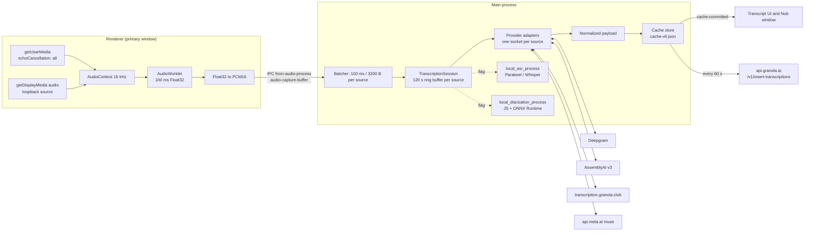
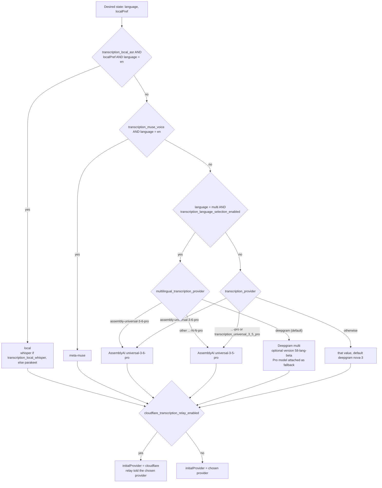
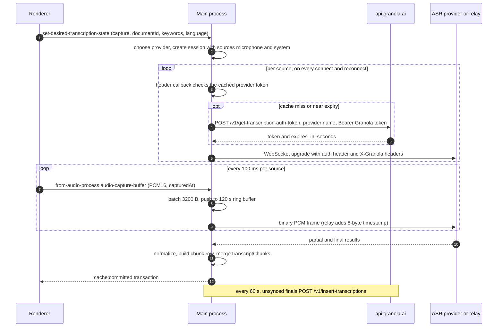
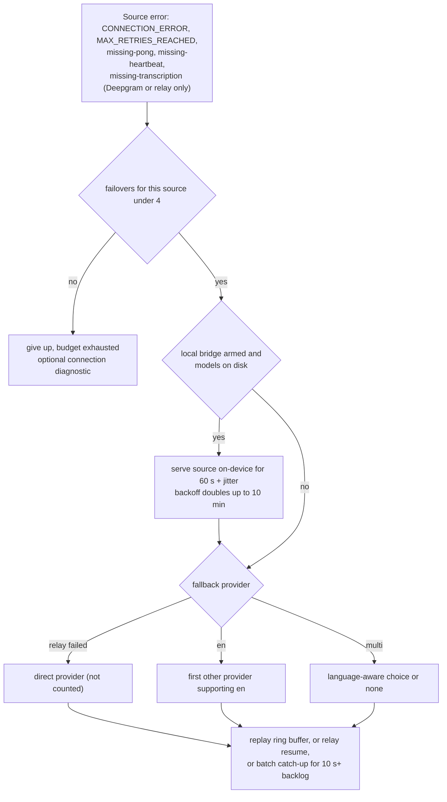

# 02 — Audio capture and transcription

How Granola desktop **v7.663.2 (macOS universal build)** turns meeting audio into a live transcript: where the audio comes from, how a speech-to-text provider is picked and authenticated, what goes over the wire, how results are normalized and stored, how the pipeline survives network failures, and what runs on-device (ASR, VAD, diarization).

Everything here comes from static reading of the extracted `app.asar` and the native Mach-O files in `Granola.app/Contents/Resources/`. Nothing was executed against Granola or any provider endpoint.

## Conventions

- **Evidence** is cited inline as `` `path@offset` ``.
  - Main-process and utility-process code is cited relative to `app.asar/dist-electron/`, e.g. `main/index.js`, `main/local-asr-protocol-DX0Mkc-d.js`, `preload/preload.js`, `audio_process/index.js`, `local_asr_process/index.js`, `local_diarization_process/index.js`.
  - Renderer chunks live in `app.asar/dist-app/assets/` and are cited by file name alone, e.g. `primary-RB5K54tJ.js`, `audioWorkletProcessor-CDVBpRB4.js`.
  - Offsets are **character offsets** (JavaScript string index in UTF-16 code units, as printed by a regex search over the decoded file). `main/index.js` and `primary-RB5K54tJ.js` contain non-ASCII text, so their UTF-8 byte offsets are higher than the cited character offsets: by roughly 13.7k–19.8k for `main/index.js` and 0.5k–2.2k for `primary-RB5K54tJ.js`, depending on the region. All other cited JS files are pure ASCII, so the two offsets coincide.
  - Native binaries are cited as `binary: symbol or string`. Binaries are `native/macos_audio_capture.node`, `granola-diarizer`, `native/macos_mic_apps_with_devices.node` and `native/ax_meeting_detector.node` under `Contents/Resources/`.
- **Tags:** **(Observed)** means it is literally in the code at the cited spot. **(Inferred)** is reasoning from the code. **(Unknown)** means the client does not show it (usually server-side behaviour). An untagged table row with an evidence column counts as Observed.
- No Granola code is reproduced. Logic is described in prose or pseudocode. No credentials appear anywhere: the client ships no provider keys, and model URLs and hashes are integrity pins, not secrets.

---

## TL;DR

- **Capture is Chromium, in the renderer.** On macOS the microphone comes from `getUserMedia` with WebRTC echo cancellation in `all` mode. System audio comes from `getDisplayMedia`, which main answers with a loopback source: a Core Audio process tap on macOS 14+, ScreenCaptureKit on macOS 13. The bundled native addon (Core Audio tap, AUHAL mic, WebRTC AEC3) is still wired up but is never selected on macOS in this build.
- **Two mono streams, not one stereo stream.** An AudioWorklet resamples to 16 kHz and cuts 100 ms Float32 frames, which are converted to PCM16 (3,200 bytes per frame). `microphone` and `system` stay separate all the way to the ASR provider, each on its own socket, so "me vs. them" comes from the capture topology, not from ML.
- **Provider choice is server-driven.** Main picks the provider from pushed feature flags plus the meeting language (`en` or `multi`) and the on-device toggle. The default is **Deepgram nova-3**. Flags can switch to AssemblyAI Universal-Streaming v3 (including Universal-3.5/3.6-Pro), Meta "muse" (English only), or on-device Parakeet/Whisper, and can tunnel the chosen cloud provider through Granola's relay at `wss://transcription.granola.club`.
- **No provider keys in the client.** Main trades the user's Granola access token at `POST /v1/get-transcription-auth-token` for a short-lived per-provider token. The token is cached in memory and fetched inside each connection attempt's header callback. The relay accepts the Granola token directly.
- **One normalized payload.** Every adapter emits the same shape: `{id, source, transcript, startUnixMs, endUnixMs, isFinal, details.words[]}`. Times are anchored to the capture time of the first frame sent on each physical socket. A stable chunk id per utterance or turn lets partial results overwrite each other in place.
- **Storage is a JSON cache, not SQLite.** Chunks live in main's cache store (`cache-v6.json`, apparently encrypted at rest) and reach the windows over the `cache:committed` IPC. Finals are uploaded every 60 s to `/v1/insert-transcriptions`. Meeting audio is not uploaded for ASR, except short catch-up clips.
- **Reliability is layered.** Layers, in order: a reconnecting websocket with backoff and a Chromium-`net`/node-`ws` transport switch; per-provider liveness detectors; a 120 s per-source replay buffer; up to 4 provider failovers per source with language-aware fallback; relay session resume; an optional on-device "bridge"; and optional batch catch-up through `/v1/transcribe-clip`.
- **Custom vocabulary.** It is built in the renderer from calendar attendees, enriched people records, the user and workspace dictionaries and the word "Granola", and capped at 100 terms. Each provider gets it in its own form: Deepgram `keyterm`, AssemblyAI `keyterms_prompt`, Meta `keywords`, sherpa hotwords, or a Whisper glossary prompt.
- **On-device ASR** (opt-in, English, flag-gated) runs in a utility process. The default engine is sherpa-onnx with **Parakeet-TDT 110M int8**; the alternative is **whisper.cpp `whisper-server`** with `small.en q5_1`. Segments are cut by a VAD with a Silero-shaped interface whose only backend in this build is a simple energy gate.
- **Speaker attribution goes beyond the channel split.** Sources: AssemblyAI `speaker_labels`, Meta `DIARIZATION` mode, a live pure-JS pyannote "community-1"-style diarizer plus ReDimNet fingerprints that tag each word `reconciled_spk`, and a post-meeting Swift/FluidAudio `granola-diarizer` that labels mic chunks "Me" or "Speaker N" against an enrolled voiceprint. All are flag-gated and off by default.

---

## 1. Capture

### 1.1 Which capture path runs

- The capture-method selector returns `browser` whenever the platform is not `win32` **or** the flag `browser_audio_capture` is on. Otherwise it returns `mac-core-audio` (darwin) or `win-v2-native` (win32). macOS is never `win32`, so macOS always gets `browser`. **(Observed)** `main/index.js@4741023`, flag default false at `main/index.js@565962`.
- A facade sends start and stop to the browser manager whenever that predicate holds. **(Observed)** `main/index.js@4741157`
- In practice, the `mac-core-audio` branch cannot be reached on macOS in 7.663.2. The `audio_process` utility is still spawned and initialised, and its capturing state and input-device calls are still consulted, but capture always starts in the renderer. **(Inferred)**

### 1.2 Microphone (renderer)

Main sends `start-audio-capture` over the `to-audio-process` IPC channel with `useCoreAudio: false`, `sampleRate: 16000` and the `documentId`. **(Observed)** `main/index.js@4735275`, `main/index.js@4736081`, sample rate constant at `main/index.js@4580929`

The renderer calls `getUserMedia` with an exact `deviceId` and the session sample rate. If the requested device is missing, it retries with the default device and logs `audio-capture-requested-device-unavailable`. **(Observed)** `primary-RB5K54tJ.js@4301277`. The voice-processing constraints depend on the server flag `transcription_mic_capture_processing` (default `default`, `main/index.js@574477`):

| Mode | echoCancellation | noiseSuppression | autoGainControl |
|---|---|---|---|
| `default` | `{ideal: "all"}` | browser default | browser default |
| `disable_echo_cancellation` | off | browser default | browser default |
| `disable_noise_suppression` | `{ideal: "all"}` | off | browser default |
| `disable_echo_and_noise_suppression` | off | off | browser default |
| `disable_all_voice_processing` | off | off | off |

Echo cancellation is turned on unless the mode disables it, and a separate option can force AGC off in any mode. **(Observed)** `primary-RB5K54tJ.js@4305456`, `primary-RB5K54tJ.js@4301745`

**(Inferred)** In Chromium, `echoCancellation: "all"` asks the WebRTC audio processing module to cancel *all* system playout, using a loopback reference, not only audio played by WebRTC itself. That is how the browser path removes the far side of the call from the mic signal, a job the native addon would otherwise do with its own AEC3.

### 1.3 System audio (renderer + main)

- The renderer calls `getDisplayMedia` with `audio: {sampleRate}` and `video: false`. It skips this when a native PCM source has been injected, which happens only on the Windows Teams path (§14). **(Observed)** `primary-RB5K54tJ.js@4300778`
- Main's display-media request handler answers with a loopback source. On macOS 14+ it returns an audio-only source named "All loopback devices" (id `loopbackAllDevices`). On older macOS it returns a screen video source with `audio: "loopback"`. **(Observed)** `main/index.js@6853285`, `main/index.js@6853964`
- At startup, main enables the Chromium feature `MacCatapSystemAudioLoopbackCapture` on macOS ≥ 14, or `MacSckSystemAudioLoopbackOverride` otherwise, together with `MacLoopbackAudioForScreenShare`. **(Observed)** `main/index.js@6813500`; the macOS-major ≥ 14 test is at `main/index.js@4632956`
- In other words, Chromium taps system audio through a Core Audio process tap on macOS 14+ and through ScreenCaptureKit on macOS 13. **(Inferred)**

### 1.4 AudioWorklet, PCM conversion and IPC

| Step | Behaviour | Evidence |
|---|---|---|
| Resample | `AudioContext` created at `sampleRate: 16000`, optionally with a silent sink (`sinkId: {type: "none"}`). Chromium does the resampling | `primary-RB5K54tJ.js@4302229` |
| Frame | Worklet reads channel 0 only (mono). It accumulates `round(sampleRate × 100 / 1000)` = 1,600 samples (100 ms) and posts them with the wall-clock time of the first sample | `audioWorkletProcessor-CDVBpRB4.js@12` |
| Convert | Each Float32 sample is clamped to [-1, 1], multiplied by 32767 and rounded to Int16 | `primary-RB5K54tJ.js@4299584` |
| Send | `sendAudioProcessMessage` on channel `from-audio-process` with event `audio-capture-buffer`. Each message carries **one** source: either `microphoneBuffer` or `systemAudioBuffer`, with the other set to `false`, plus `capturedTimestamps` | `primary-RB5K54tJ.js@4314494`, `preload/preload.js@10903` |
| Receive | Main dispatches `audio-capture-buffer` to its listeners as `(mic, system, capturedTimestamps)` | `main/index.js@4736276` |

### 1.5 Main-side batching

- A batcher class (`WMe`) keeps one accumulator per source. It forwards a batch every 100 ms of audio: sampleRate × 1 channel × 2 bytes × 100/1000 = **3,200 bytes at 16 kHz**. Each batch is stamped with the capture time of its first sub-buffer. **(Observed)** `main/index.js@4742073`, `main/index.js@4742332`
- Batches go to the transcription session's `sendAudioBuffer(source, pcm, capturedAtUnixMs)`. **(Observed)** `main/index.js@6830832`, `main/index.js@5176993`
- A muted source is not dropped. It is replaced by zero-filled PCM of the same length, so timestamps and provider timing keep moving. **(Observed)** `main/index.js@5177168`
- Debug dump: the flag `save_audio` (default false) writes `<ts>_microphone.wav` and `<ts>_system.wav` (16-bit mono 16 kHz) to `userData/audio_files` and deletes them after 7 days. **(Observed)** `main/index.js@571451`, `main/index.js@4691930`, `main/index.js@4692717`
- The flag `voice_fingerprint_poc` also records the mic stream to `userData/voice_fingerprint/<doc>_microphone_16k.wav`, with periodic unix-time anchors. This file feeds the post-meeting diarizer (§12.2). **(Observed)** `main/index.js@6764695`, `main/index.js@6765259`

### 1.6 The dormant native path: `macos_audio_capture.node`

The addon is still shipped, and it is a complete capture stack:

| Capability | Evidence (binary unless noted) | Tag |
|---|---|---|
| Core Audio **process tap**: mono, global, excludes no processes, private, unmuted; macOS ≥ 14.2 only; plus a private aggregate device | `macos_audio_capture.node: _AudioHardwareCreateProcessTap`, `CATapDescription initMonoGlobalTapButExcludeProcesses:`, `"Granola-Audio-Tap"`, `"Granola-Aggregate-Audio-Device"`, `___isPlatformVersionAtLeast(1,14,2,0)` | Observed |
| **ScreenCaptureKit** fallback (`SCStream`, 1 channel, `capturesAudio`), chosen by `useCoreAudio`, which follows flag `core_audio` (default true) | `macos_audio_capture.node: ScreenCaptureKitListener`, `setChannelCount:`, `setCapturesAudio:`; `main/index.js@566753` | Observed |
| Mic through an **AUHAL** unit (`auou/ahal/appl`), not VoiceProcessingIO | `macos_audio_capture.node: __TEXT,__const 0x6f938`, `"enable IO on input"` | Observed |
| Statically linked **WebRTC AEC3**. System audio is the far-end reference; 10 ms frames | `macos_audio_capture.node: webrtc::EchoCanceller3::AnalyzeRender`, `ProcessCapture`, `setFrameSize:` = sampleRate/100 | Observed (roles Inferred) |
| AEC bypass when the output device looks like headphones (flag `disable_echo_cancellation_on_headphones`) | `macos_audio_capture.node: OutputDeviceNameIsHeadphones`, `"AirPods"`; `main/index.js@567186` | Observed (bypass Inferred) |
| Gain compensation against OS input-volume changes (flag `automatic_gain_compensation`) | `macos_audio_capture.node: -[CombinedAudioCapture applyAutoGain:]`, `inputVolumeDidChange`; `main/index.js@565815` | Observed (purpose Inferred) |
| Power assertion while recording | `macos_audio_capture.node: IOPMAssertionCreateWithName`, `"Recording microphone and system audio"` | Observed |

**Why it is dormant.** Mechanically, the selector in §1.1 never returns `mac-core-audio` on darwin. **(Observed)** Granola's reasons are not in the code. **(Unknown)** A plausible reading is that Chromium now provides CATap/ScreenCaptureKit loopback and system-wide echo cancellation itself, which made the custom stack redundant on macOS. **(Inferred)** The addon has not become dead weight, though: the mic-apps utility still loads it to read the default input device. **(Observed)** `macos_mic_apps_with_devices_process/index.js@549`

The `audio_process` utility that hosts it is a thin shim. The addon path arrives as `argv[2]`, and the shim calls `startAudioCapture(useCoreAudio, disableECOnHeadphones, enableAGC, sampleRate, callback)` (`audio_process/index.js@2670`). It reposts buffers using the same `audio-capture-buffer` shape (`@2724`). Its only DSP is a 100 ms RMS level meter (`@301`). Main restarts it up to 20 times, and also when it exceeds a memory cap. **(Observed)** `main/index.js@4732737`, `main/index.js@4733158`

---

## 2. Provider selection

### 2.1 Inputs

| Input | Source | Evidence |
|---|---|---|
| `language`: `en` or `multi` | Renderer preference. It is honoured only if flag `transcription_language_selection_enabled` is on, and forced to `en` while on-device transcription is active | `primary-RB5K54tJ.js@3169347` |
| `localTranscription` | Renderer toggle "On-device transcription", sent only when flag `transcription_local_asr` is on | `primary-RB5K54tJ.js@3167738`, `@3169393` |
| Desired state | IPC `set-desired-transcription-state` with `{capture, documentId, keywords, language, localTranscription?, …}` | `primary-RB5K54tJ.js@3169723`, `main/index.js@6829984` |
| Flags | Main cache store `featureFlags[id]`, falling back to the bundled default | `main/index.js@4597402` |

### 2.2 Decision procedure

- The chooser and its branches are **(Observed)**: top `main/index.js@5170251`, local `@5170343`, Meta `@5170466`, multilingual `@5170562` / `@5170806`, default `@5170928`. It is called with the desired-state language and local flag at `@5175037`. The relay overlay is `@5143063`.
- The relay overlay is unconditional in the session constructor, and the relay connection forwards `config.provider` as its `provider` query parameter (`main/index.js@5169061`). The relay's `ready` message only validates `deepgram` or `assembly-universal` (`main/index.js@5046431`). What happens when the choice is local or Meta with the relay on is **(Unknown)**. It probably fails over to the direct provider. **(Inferred)**
- An unknown provider string falls back to Deepgram, with a log entry `unknown-transcription-provider`. **(Observed)** `main/index.js@5169853`
- The client contains no A/B logic. Experiments are presumably run by assigning flag values server-side; the client can only ask for defaults through headers such as `X-Force-Default-Flags`. **(Inferred)** `main/index.js@480663`

### 2.3 Transcription flags (main process)

| Flag | Default | Effect | Evidence |
|---|---|---|---|
| `transcription_provider` | `deepgram` | Main selector | `main/index.js@574725` |
| `multilingual_transcription_provider` | `deepgram` | Selector for `multi` | `main/index.js@570082` |
| `multilingual_deepgram_nova_3_mega` | false | Deepgram `version=58-lang-beta` ("nova-3-mega") | `main/index.js@570021`, `@4973139` |
| `transcription_universal_3_5_pro` | false | Force AssemblyAI Universal-3.5-Pro | `main/index.js@575034` |
| `transcription_universal_3_5_pro_multilingual_fallback` | false | Attach a Pro model as the multilingual fallback | `main/index.js@575093` |
| `transcription_language_selection_enabled` | false | Allow `multi` | `main/index.js@574017` |
| `cloudflare_transcription_relay_enabled` | false | Route through Granola's relay | `main/index.js@566535` |
| `transcription_muse_voice` | false | Meta muse for `en` | `main/index.js@574619` |
| `transcription_local_asr` / `transcription_local_whisper` | false / false | On-device ASR / Whisper engine | `main/index.js@574186`, `@574422` |
| `transcription_local_bridge` | false | On-device stop-gap during failover (darwin-arm64, `en`) | `main/index.js@574303`, `@5143207` |
| `mip_opt_out` | **true** | Deepgram Model Improvement Program opt-out | `main/index.js@569933` |
| `deepgram_dedicated_endpoint` | false | Use host `d315810d.api.deepgram.com` | `main/index.js@566884`, `@4973025` |
| `transcription_assembly_endpoint` | `edge` | AssemblyAI region: `edge`, `us` or `eu` | `main/index.js@572585`, `@5015501` |
| `transcription_assembly_turn_detection` | `default` | `balanced` / `conservative` presets | `main/index.js@572778` |
| `transcription_assembly_3_5_pro_confidence_filter` | 0 / 0 | Client-side word and language confidence gates | `main/index.js@572316` |
| `transcription_diarization_universal_3_5_pro` | false | AssemblyAI `speaker_labels` | `main/index.js@573163` |
| `transcription_en_language_detection` | false | AssemblyAI `language_detection` even for `en` | `main/index.js@573233` |
| `transcription_liveness_timeout_seconds` | deepgram 30, assembly 10 | Stall and pong timeouts | `main/index.js@574089` |
| `transcription_socket_retry_policy` | false | Socket retries before failover | `main/index.js@574834` |
| `transcription_buffer_commit_eviction` | false | Commit-based audio buffer eviction | `main/index.js@572914` |
| `transcription_catchup_batch` | false | Batch transcription of backlog | `main/index.js@572978` |
| `transcription_net_websocket` / `transcription_autoswitch_ws_transport` | false / false | Prefer Chromium `net` websocket / allow transport switching | `main/index.js@574670`, `@572850` |
| `transcription_connection_diagnostic` | false | DNS/TLS/WS probe after failover is exhausted | `main/index.js@573100` |
| `persist_transcription_details` | false | Keep word-level details on chunks | `main/index.js@571082` |
| `transcription_recovery` | null | Server-triggered re-upload window | `main/index.js@574783` |
| `transcription_speaker_reconciliation_local` | false | Live on-device diarization | `main/index.js@574895` |
| `transcription_mic_capture_processing` | `default` | Mic voice-processing mode (§1.2) | `main/index.js@574477` |

Renderer-only: `transcription_keyterm_phrases` (`cache-B8uVNU4r.js@54652`) and `workspace_jargon` (`cache-B8uVNU4r.js@60219`). **(Observed)**

---

## 3. Auth: the transcription token broker

**Common mechanism (Observed)**

1. The Granola access token is read from the stored account and refreshed through `refresh-access-token` when less than 2 minutes remain. `main/index.js@4773598`, `@4773908`
2. Provider tokens: `POST https://api.granola.ai/v1/get-transcription-auth-token` with body `{provider}` (`deepgram`, `assembly-universal` or `meta-muse`), `Authorization: Bearer <granola token>`, and the standard Granola client headers. One retry. `main/index.js@485118`, `main/logs-transport-0BuDxWnM.js@35980`, `main/index.js@480191`
3. The response is read as `{token, expires_in_seconds}`. `main/index.js@4973898`, `@4973939`
4. Tokens are fetched lazily inside each socket's header provider, which runs on every connect attempt. `main/index.js@4967111`

| Provider | Cache rule | Default TTL if the server omits one | How the token is presented | Evidence |
|---|---|---|---|---|
| Deepgram | Reuse while > 30 min remain. In the last 30 min, refresh at most every 2 min. On failure, keep using the cached token. Fetch timeout 20 s | 1 h | `Authorization: Bearer <token>` | `main/index.js@4973197`, `@4973454`, `@4974150`, `@4975818`, `@4975996` |
| AssemblyAI v3 | Reuse until 30 s before expiry. Fetch timeout 20 s | 5 min | `Authorization: <token>` (no `Bearer`) plus `AssemblyAI-Version: 2025-05-12` | `main/index.js@5026852`, `@5026963`, `@5027266`, `@5031254` |
| Meta muse | Reuse while > 5 min remain | 24 h | Not a header: sent in the first JSON message as `authorization.accessToken` | `main/index.js@5096927`, `@5097259`, `@5101988` |
| Granola relay | None | — | `Authorization: Bearer <granola access token>`. The relay holds provider credentials server-side | `main/index.js@5057441` |

- Every direct provider socket also carries `User-Agent: Granola/<ver> (<platform>; <arch>)`, `X-Granola-App-Version`, `X-Granola-Connection-Id` and `X-Granola-Source`, even toward Deepgram and AssemblyAI. **(Observed)** `main/index.js@4956891`
- The backend probably mints Deepgram temporary JWTs and AssemblyAI v3 temporary streaming tokens. The scopes, upstream calls and user binding are not visible. **(Inferred / Unknown)**
- A build feature `DEEPGRAM_TOKEN_REFRESH` is defined, but nothing in this bundle reads it. Tokens refresh only on demand. **(Observed)** `main/index.js@4581511`

---

## 4. Per-provider connection parameters

### 4.1 Deepgram (direct)

The URL is `wss://api.deepgram.com/v1/listen`, or the dedicated host. The query string is rebuilt on **every** connect, so keyword changes take effect on the next reconnect. **(Observed)** `main/index.js@4973025`, `@4976171`, `@4977222`

| Param | Value | Evidence |
|---|---|---|
| `model` | `nova-3` | `main/index.js@4976661` |
| `version` | omitted, or `58-lang-beta` (labelled "nova-3-mega") | `main/index.js@4973139` |
| `encoding` / `sample_rate` / `channels` | `linear16` / `16000` / `1` | `main/index.js@4976661` |
| `smart_format` / `interim_results` / `profanity_filter` | `true` / `true` / `false` | `main/index.js@4976661` |
| `mip_opt_out` | flag, default `true` | `main/index.js@569933` |
| `language`, `endpointing` | only for `multi`: `multi`, `100` | `main/index.js@4976994` |
| `keyterm` (repeated) | trimmed to a ~400-unit budget; each term costs max(words × 5, ⌈chars / 2⌉) | `main/index.js@4957380`, `@457363`, `@457200` |

- Not used anywhere in the bundle: `diarize`, `punctuate`, `utterance_end_ms`, `vad_events`, `multichannel`, and the `CloseStream`/`Finalize` messages. **(Observed by absence)** `SpeechStarted` and `UtteranceEnd` messages are explicitly ignored. `main/index.js@4980399`
- The URL builder still contains a legacy `keywords=<term>:0.4` path (first 50 terms). **(Observed)** `main/index.js@4957292`. The Deepgram adapter never uses it. **(Inferred)**

### 4.2 AssemblyAI Universal-Streaming v3

The URL is `wss://streaming.assemblyai.com/v3/ws` for `edge`, or the `streaming.us.` / `streaming.eu.` hosts. **(Observed)** `main/index.js@5015501`

| Param | Value / condition | Evidence |
|---|---|---|
| `sample_rate`, `format_turns`, `filter_profanity` | `16000`, `true`, `false` | `main/index.js@5030395` |
| `speech_model` | the Pro model if one was selected, else `universal-streaming-multilingual` for `multi`, else `universal-streaming-english` | `main/index.js@5016491`, `@5015635` |
| `keyterms_prompt` | JSON array, ≤ 100 terms | `main/index.js@5030359`, `@5039715` |
| `speaker_labels` | `true` when a Pro model is used and the diarization flag is on | `main/index.js@5030513` |
| `language_detection` | `true` for `multi`, the en-detection flag, or a language-confidence gate > 0 | `main/index.js@5030561` |
| `language_codes` | `["en"]` for a Pro model outside `multi` | `main/index.js@5030691` |
| `session_heartbeat` | `true` in heartbeat-liveness mode | `main/index.js@5030763` |
| `acknowledge_silence` | Pro model plus flag `transcription_assembly_acknowledge_silence` | `main/index.js@5030862` |
| Turn presets (English model) | `balanced`: end-of-turn threshold 0.8, min silence when confident 800 ms, max turn silence 2400 ms. `conservative`: same, but 3600 ms. Pro models only get a max-turn-silence override | `main/index.js@5015818`, `@5015930`, `@5016307` |

- No `encoding` parameter is sent. **(Observed)** The client relies on AssemblyAI's default `pcm_s16le`. **(Inferred)**
- Client → server messages: binary PCM; `UpdateConfiguration` with new `keyterms_prompt` for live keyword updates; `Terminate` on stop. **(Observed)** `main/index.js@5039020`, `@5029579`
- Server messages handled: `Begin`, `Turn`, `Termination`, `SpeechStarted`, `Heartbeat`, `Error`, `SpeakerRevision`, `Silence`. **(Observed)** `main/index.js@5036641`

### 4.3 Granola relay (`cloudflare`)

The URL is `wss://transcription.granola.club/transcription`. After the relay announces a release, reconnects use `/v/<release>/transcription`, which pins them to the same server version. **(Observed)** `main/index.js@5058031`, `@5057797`

| Param | Meaning | Evidence |
|---|---|---|
| `document_id`, `connection_id` | `connection_id` is stable across reconnects, which enables resume | `main/index.js@5055885` |
| `source`, `sample_rate`, `language`, `provider` | Per-source stream description; `provider` is the upstream choice | `main/index.js@5055885` |
| `deepgram_dedicated_endpoint`, `mip_opt_out`, `keywords` (JSON, ≤ 100), `deepgram_model_version` | Deepgram options forwarded | `main/index.js@5056201` |
| `assembly_relay_version=1`, `assembly_config` (JSON) | AssemblyAI options: model, endpoint, turn detection, confidence gates, language detection, speaker labels, acknowledge silence | `main/index.js@5056555`, `@5017105` |

The provider name `cloudflare` suggests a Cloudflare-hosted service that runs the same Deepgram/AssemblyAI adapters server-side and returns Granola-normalized payloads. **(Inferred)**

### 4.4 Meta muse

| Item | Value | Evidence |
|---|---|---|
| URL | `wss://api.meta.ai/v1/asr/realtime?sessionId=granola-<uuid>` | `main/index.js@5096774`, `@5098983` |
| Model | `muse-voice-transcribe-1.0` | `main/index.js@5096774` |
| First text frame | `authorization.accessToken`, `audioEncoding: PCM_16KHZ` (24 kHz branch exists), `mode: DIARIZATION`, `partialMode: CUMULATIVE`, `emitAudioProgress`, `languageBias: ["English"]`, `keywords` (≤ 100) | `main/index.js@5101988`, `@5102203`, `@5105350` |
| Startup | Audio is held, up to 600 frames, until the server returns a `sessionId` | `main/index.js@5104732` |

The 24 kHz branch is unreachable in practice, because main always runs at 16 kHz. **(Inferred)**

---

## 5. Audio framing and keepalives

| Provider | Wire frame | Keepalive / liveness | Close |
|---|---|---|---|
| Deepgram | Raw PCM16, one per 100 ms | `KeepAlive` JSON every 3 s (`main/index.js@4978885`) | Socket close with code 1000 `graceful_shutdown`, no `CloseStream` (`@4961915`) |
| AssemblyAI | Raw PCM16 | WS ping every 5 s (node `ws` only) or server `Heartbeat` messages (`main/index.js@5033476`) | `Terminate`, then wait for `Termination` (`@5029579`) |
| Relay | **8-byte little-endian float64 capture time + PCM** (`main/index.js@5057680`, `@5045916`) | `ping` every 10 s, expects `pong` | `stop`, only when the upstream is AssemblyAI, then wait for `stopped` (`@5049526`) |
| Meta | Raw PCM16 | No keepalive. Liveness check every 30 s; the session rolls over (`endStream` + reconnect) at 55 min (`main/index.js@5096845`, `@5105844`) | `endStream`, wait up to 5 s (`@5102349`) |

The relay header lets the server re-anchor timing per frame and answer resume requests with a `receivedThroughUnixMs`. **(Inferred)**

---

## 6. Response normalization and the transcript chunk model

### 6.1 The normalized payload (Observed)

Every adapter emits `{id, source, transcript, startUnixMs, endUnixMs, isFinal, …}`. Optional fields are `wordTimingDurationMs`, `isRevision`, `providerSpeakerLabelsPending`, `suppressShownPartial`, and `details`. `details` holds `words[]`, where each word is `{w, s_ms, e_ms, conf, spk, spk_conf?, lang?, lang_conf?, first_pass_spk?}`, plus `endOfTurnConfidence`, `provider`, `model` and `timingAnchorUnixMs`. Evidence: `main/index.js@4983042`, `@4983005`; the relay validator is at `@5046145`.

**Timing anchor.** The socket layer records the capture time of the **first audio frame sent on each physical connection** on the socket object, and every inbound result is offset from it. **(Observed)** `main/index.js@4963304`. Provider-relative timestamps restart at 0 on every new connection, so this is what keeps wall-clock times correct across reconnects and replays. **(Inferred)**

| Provider | Chunk id strategy | Final when | Partial rate | Word timing / speaker |
|---|---|---|---|---|
| Deepgram | One id reused for all interim results until a final arrives (`main/index.js@4981721`) | `is_final` (`@4980982`) | every `Results` message | seconds × 1000, `punctuated_word`, `speaker` if present (`@4955952`) |
| AssemblyAI | One UUID per `turn_order`, up to 64 tracked turns (`main/index.js@5026655`) | `end_of_turn` and `turn_is_formatted`; the unformatted end-of-turn message is skipped (`@5018928`, `@5023218`) | debounced to ≤ 1 per 500 ms; finals flush immediately (`@5022295`) | already in ms, plus `spk_conf`, `lang`, `lang_conf` (`@4956395`) |
| Meta | Turn tracker folds `speechStart`, cumulative `transcript`, `speaker`, `speechEnd` and `speechComplete` | `speechComplete` | ≤ 1 per 300 ms per turn (`main/index.js@5103743`) | a final is one pseudo-word holding the whole text, with the majority speaker; labels get a session-index prefix after a rollover (`@4956170`, `@5104093`) |
| Relay | Already normalized (`transcription{payload}`) | as sent | as sent | as sent |
| Local | One id per segment | `segment` message | `partial` messages | `spk` always null (`main/index.js@5092713`) |

Other events: per-word language counts (`languageDetection`, `main/index.js@4981278`), and `committedThrough`, which is emitted on non-revision finals, AssemblyAI `Silence` and relay `committed-through` (`@4972693`, `@5037425`). AssemblyAI `SpeakerRevision` re-emits earlier finals with `isRevision: true` and updated `spk`. **(Observed)** `main/index.js@5036641`

### 6.2 Chunk row

The session's `deliverTranscription` turns a payload into a row: `{id, document_id, start_timestamp, end_timestamp, text, source, is_final, transcriber_user_id: null, detected_speaker_name, transcription_session_id, detectedSpeaker?, providerDetails?, providerSpeakerLabelsPending?}`. Timestamps are ISO strings. **(Observed)** `main/index.js@5070869`, `@5071146`

- `providerDetails` (word level) is kept only when `persist_transcription_details` is on, for system audio with active-speaker attribution, with Pro-model diarization, with Meta, or with local speaker reconciliation. **(Observed)** `main/index.js@5070706`
- For `system` chunks, `detectedSpeaker` / `detected_speaker_name` appear to come from meeting-app active-speaker detection, behind flags `zoom_speaker_attribution`, `teams_speaker_attribution` and `meet_chrome_native_speaker_attribution` (flags at `main/index.js@576616`, `@572208`, `@569475`). **(Inferred)**

---

## 7. Persistence and upload

1. The row is dispatched as `mergeTranscriptChunks` into main's cache store. Finals are also added to an unsynced set. **(Observed)** `main/index.js@5071333`
2. If a stream restarts fresh in commit-eviction mode, its outstanding partials are retracted with `deleteLocalPartialTranscriptChunks`. **(Observed)** `main/index.js@5067736`, `@5156711`
3. The store broadcasts each committed transaction over `cache:committed` to the primary window and the floating "Nub" window. The renderer selects `transcripts[documentId]` and merges partials by chunk id. **(Observed)** `main/index.js@6851256`, `preload/preload.js@2459`, `useTranscriptChunks-BN5Bl-pc.js@593`
4. Local file: `cache-v6.json` in `userData`, with throttled writes. **(Observed)** `main/index.js@4595341`. It is probably encrypted at rest: a `cache-v6.json.enc` path and an AES-256-GCM transform sit nearby. **(Inferred)** `main/index.js@6694817`, `@4588371`
5. Transcripts are **not** stored in SQLite: the Drizzle schema has no transcript table. **(Observed)** `getAPIEndpointInWindow-Did_2krX.js@668`
6. Cloud: every 60 s (`TRANSCRIPT_SYNC`), unsynced finals are POSTed to `https://api.granola.ai/v1/insert-transcriptions` as `{chunks: [...]}`. Word details are mapped to snake_case (`words`, `end_of_turn_confidence`, `provider`, `model`, `timing_anchor_unix_ms`, `speaker_participant_id`, …). **(Observed)** `main/index.js@4930191`, `@4930767`, `@4930915`, `main/logs-transport-0BuDxWnM.js@39506`
7. Recovery: the server flag `transcription_recovery {id, startDate, endDate}` makes the client re-upload local finals in that window, in batches of 50 with 2 s gaps. **(Observed)** `main/index.js@6731586`, `@6730353`

Main also pushes `audio-system-state` and `meeting-transcription-state` (`{language, model, provider}`) to the renderer for status UI. **(Observed)** `main/index.js@4734833`, `@5143644`

---

## 8. Reliability

### 8.1 Socket layer (shared by all providers)

- **Backoff:** `delay = min(minDelay × 1.3^(attempt − 1), maxDelay)`. Defaults: `minDelay` random in 1–5 s, `maxDelay` 10 s, connect timeout 4 s, a connection counts as stable after 5 s, unlimited retries. AssemblyAI overrides to 200 ms min / 500 ms max. HTTP 429 on the handshake counts as retryable. **(Observed)** `main/index.js@4960654`, `@4959368`, `@5031574`, `@4967675`
- **Transports:** Chromium `net.WebSocket` (`electron-net`) or node `ws`. Only node `ws` supports ping/pong. On an inbound stall, a missing pong or a missing heartbeat, the socket first retries over the *other* transport, logging `reconnecting-websocket-transport-switch`. **(Observed)** `main/index.js@4960348`, `@4964812`. `electron-net` is presumably there to pick up Chromium's proxy and certificate handling on corporate networks. **(Inferred)**
- **Queueing:** frames sent while the socket is not open are queued in memory (unbounded by default) and flushed on open. **(Observed)** `main/index.js@4963864`, `@4969471`

### 8.2 Liveness detectors

| Provider | Detector | Evidence |
|---|---|---|
| Deepgram | No inbound message for 30 s while audio was being sent → transport switch, else `missing-transcription` | `main/index.js@4978997`, `@4979808`, `@4972052` |
| AssemblyAI | Missing pong (5 s pings, 10 s timeout) or missing server heartbeat → transport switch, else failover | `main/index.js@5033747`, `@5034749` |
| Relay | Inbound stall (Deepgram upstream), missing pong, or no `ready` after open | `main/index.js@5050819`, `@5051559`, `@5052625` |
| Meta | Handshake not acknowledged in 10 s → reconnect. Silence from the server while sending → `missing-transcription` | `main/index.js@5096845`, `@5106342` |

### 8.3 Session-level failover

- Failover budget: 4 per source. Socket retries before failover: AssemblyAI 3, relay 3, Deepgram/local/Meta unlimited. With `transcription_socket_retry_policy` on, it becomes 3 whenever a fallback exists. **(Observed)** `main/index.js@5140919`, `@5163553`, `@5166036`
- Fallback order for `en`: relay → the direct provider (`main/index.js@5163952`); Deepgram ↔ AssemblyAI (`@5140658`, `@5141198`); local or Meta → AssemblyAI (`@5141056`). **(Observed)**
- Fallback for `multi`: Deepgram (nova-3 or nova-3-mega) first, then AssemblyAI. A candidate qualifies only if it supports **every** language with at least 10 detected words (`transcription_fallback_language_min_words`), according to the per-model lists in `transcription_fallback_supported_languages`. Otherwise there is no fallback (`insufficient-evidence`). **(Observed)** `main/index.js@5141485`, `@5141372`, `@573296`, `@573365`. The multilingual AssemblyAI fallback only works when a Pro model was attached at selection time, which is why the chooser attaches one to Deepgram-multi sessions. **(Inferred)**
- A failure at startup goes straight to the fallback provider (`transcription-startup-fallback`, `main/index.js@5154741`). **(Observed)**
- Mid-meeting config changes are classified as `provider_change`, `language_change` or `keyword_change`. Keyword changes are applied in place where the provider allows it: AssemblyAI `UpdateConfiguration`, a relay `keywords` message, Deepgram on the next reconnect, Meta on the next session. Provider or language changes restart the session for the same document. **(Observed)** `main/index.js@5171775`, `@5175700`, `@5057233`

### 8.4 Audio buffering, resume and catch-up

- **Ring buffer:** each source keeps 120 s of 100 ms frames, keyed by capture time and evicted by age. **(Observed)** `main/index.js@5139800`. By default, frames are drained to the live connection immediately and accumulate only while a replacement provider is starting; they are replayed once it connects. **(Observed)** `main/index.js@5151597`, `@5157032`
- **Commit eviction** (flag): frames stay in the buffer until the provider commits past them (finals, `Silence`, relay `committed-through`). After a reconnect, only uncommitted audio is replayed. **(Observed)** `main/index.js@4972693`, `@5037425`
- **Relay resume:** if the relay answers `ready{resumed: true, receivedThroughUnixMs}`, only frames captured after that time are replayed. **(Observed)** `main/index.js@5054219`, `@5156929`
- **Batch catch-up** (flag): on a fresh reconnect with ≥ 10 s of backlog, the most recent ≤ 120 s of backlog (gaps over 1 s filled with silence) is POSTed as base64 PCM to `https://berry.api.granola.ai/v1/transcribe-clip`. The results become final chunks with provider `assembly-batch`, while the live stream carries on with newer audio. **(Observed)** `main/index.js@5140646`, `@5040295`, `@5040526`, `@5042277`, `@5041371`, `main/logs-transport-0BuDxWnM.js@53513`
- **Local bridge** (flag, darwin-arm64, `en`): during failover, if the on-device model and runtime are already downloaded, the source is served locally for 60 s plus up to 60 s of jitter, doubling each round up to 10 min, before the cloud is retried. **(Observed)** `main/index.js@5161903`, `@5162390`, `@5162761`, `@5166474`

### 8.5 Telemetry (brief)

A `transcription-stats` heartbeat goes out every 60 s with partial/final counts, word counts per source, time to first audio and first chunk, latency sums, failovers and restarts by cause. There are also per-adapter latency logs every 2 min, a per-session language summary, and an optional DNS/TLS/WS connection diagnostic. **(Observed)** `main/index.js@4994139`, `@5001083`, `@4992485`. The network allowlist hard-codes the ASR hosts (`*.granola.club`, `api.deepgram.com`, the dedicated Deepgram host, `*.assemblyai.com`, `api.meta.ai`). **(Observed)** `main/index.js@5042548`

---

## 9. Custom vocabulary and language

### 9.1 Keyword list (renderer)

A builder takes `{people, calendarEvent, userDictionary, workspaceDictionary, keytermPhrases}`. **(Observed)** `api-CCQ12bLQ.js@221981`, `primary-RB5K54tJ.js@3166301`

- **Sources:** the user dictionary; the workspace "jargon" dictionary (flag `workspace_jargon`); the calendar creator, organizer and attendees (non-declined first, with resource, group and system addresses excluded); enriched people records (name parts, employer, company); and the constant "Granola". **(Observed)** `api-CCQ12bLQ.js@221718`, `const-JKbdk96v.js@77071`, `api-CCQ12bLQ.js@219930`
- **Shaping:** dictionary entries are split on commas and de-duplicated case-insensitively. Each term must be 2–50 characters and at most 6 words. Names are split into single words unless `transcription_keyterm_phrases` is on, in which case full names and companies stay as phrases. **(Observed)**
- **Order and cap:** the first 20 name terms, then dictionary terms, then the remaining names, then defaults. At most **100** in total. **(Observed)** `api-CCQ12bLQ.js@222509`
- A session does not start until a keyword list exists (`transcription-no-keywords`). **(Observed)** `main/index.js@5175070`

| Consumer | Form and limit | Evidence |
|---|---|---|
| Deepgram | repeated `keyterm`, ~400-unit budget | `main/index.js@457363` |
| AssemblyAI | `keyterms_prompt` ≤ 100, live `UpdateConfiguration` | `main/index.js@5030359` |
| Relay / Meta | `keywords` ≤ 100 | `main/index.js@5056201`, `@5105350` |
| Parakeet (local) | sherpa hotwords joined with `/`, score 2, ≤ 100 | `main/index.js@5093850`, `main/local-asr-protocol-DX0Mkc-d.js@3592` |
| Whisper (local) | "Glossary: …" prompt, ≤ 30 terms | `main/local-asr-protocol-DX0Mkc-d.js@3711` |

Apart from the unused legacy Deepgram `:0.4`, no per-term boosting weights are used. **(Inferred)**

### 9.2 Language

- The UI offers `en` ("English (best quality)") and `multi` ("Multi-language"). On-device transcription is English-only. **(Observed)** `PortraitPage-u6X9nSDs.js@1610642`
- `multi` uses Deepgram nova-3 with `language=multi&endpointing=100` (optionally `58-lang-beta`), or AssemblyAI multilingual or a Pro model with `language_detection`. Meta and local are never chosen for `multi`. **(Observed)** §4
- Detected-language evidence (Deepgram per word, AssemblyAI per turn) is aggregated per session. It feeds the multilingual fallback and telemetry. **(Observed)** `main/index.js@4992485`. Whether it is used later, for example to pick the summary language, is **(Unknown)**.

---

## 10. On-device ASR

### 10.1 When it runs

- A renderer toggle, "On-device transcription", whose description says it works offline, is English-only and is slightly less accurate with jargon. When on, it forces language `en`. **(Observed)** `primary-RB5K54tJ.js@1843960`, `@3169393`
- It also requires the flag `transcription_local_asr`. The engine is Whisper if `transcription_local_whisper` is on, else Parakeet. The same process serves the local bridge (§8.4). **(Observed)** `main/index.js@5170343`
- Dictation does not use it: dictation records with `MediaRecorder` and uploads. **(Observed)** `useGlobalDictation-DX1pPpqE.js@16606`

### 10.2 Engines

| | Parakeet (default) | Whisper (flag) |
|---|---|---|
| Runtime | sherpa-onnx native binding with ONNX Runtime 1.27.0, downloaded per platform (`main/index.js@5083591`, `@5084034`) | whisper.cpp `whisper-server` v1.9.1, Metal build on darwin-arm64 (`main/local-asr-protocol-DX0Mkc-d.js@1241`) |
| Model | `sherpa-onnx-nemo-parakeet_tdt_transducer_110m-en-36000-int8` (~108 MB tarball: int8 encoder/decoder/joiner + tokens) plus a BPE vocab (`main/local-asr-protocol-DX0Mkc-d.js@65`, `@366`, `@832`) | `ggml-small.en-q5_1` (~190 MB) (`main/local-asr-protocol-DX0Mkc-d.js@1037`) |
| Decoding | offline NeMo transducer, 80-dim features, 2 CPU threads, `modified_beam_search` with hotwords (`local_asr_process/index.js@8912`, `@9222`) | HTTP POST of a 16 kHz WAV per segment to `/inference` on 127.0.0.1, `temperature=0.0`, JSON output, 4 threads by default (`local_asr_process/index.js@10941`, `@11161`; `main/index.js@5086804`) |
| Biasing | hotwords, score 2 | glossary prompt. Finals are decoded with and without it; the prompted text is kept only if its length is within 0.6× to 1.8×+80 chars of the unprompted one (`main/local-asr-protocol-DX0Mkc-d.js@3878`) |
| Word timing | BPE token timestamps merged into words; word end = min(next start, start + 2 s) | evenly spaced synthetic timings; partials stabilised by a longest-common-prefix tracker (`local_asr_process/index.js@345`) |
| Fallback | — | downgrades to Parakeet if the binary or model is unavailable (`main/index.js@5094216`) |

All models and runtimes come from a CloudFront `/models` bucket, are streamed to `.partial` files while being SHA-256 hashed, and are re-verified by the worker before loading. **(Observed)** `main/index.js@5078599`, `@5079540`, `main/vad-DV5nDmKQ.js@13290`

### 10.3 Segmenter and protocol

| Constant | Value | Evidence |
|---|---|---|
| Hop | 512 samples (32 ms at 16 kHz) | `local_asr_process/index.js@666` |
| Close segment after | 25 silent hops (800 ms) | same |
| Pre-roll / pad | 8 hops (256 ms) | same |
| Minimum voiced hops to decode | 6 (192 ms) | same |
| Max segment | 25 s | same |
| Partial cadence | every 31 hops (~1 s) | same |

- Main → worker messages: `audio{pcm}`, `keywords`, `skip{gapMs}`, `ping`, `force-finalize`, `finalize`, `shutdown`. Worker → main: `ready{modelLoadMs}`, `partial`, `segment`, `progress{committableThroughMs}`, `pong`, `finalized{telemetry}`, `error`. A segment is `{segmentId, startMs, endMs, text, words[{w, s_ms, e_ms}], decodeMs}`. **(Observed)** `main/local-asr-protocol-DX0Mkc-d.js@4662`, `@5035`
- Main-side policy: model-load timeout 120 s, finalize timeout 15 s, up to 60 s of audio queued before `ready`, ping every 30 s, and failure after 2 missed pongs. A `skip` is sent when capture timestamps jump by more than 3 s. **(Observed)** `main/index.js@5086665`, `@5089499`
- Segments become chunks with `provider: "local"` and absolute time = anchor + `startMs`. **(Observed)** `main/index.js@5092148`, `@5092713`

---

## 11. VAD

- The bundle contains a streaming VAD class whose state is a 256-float vector, with a 64-sample context and 576-sample inputs (64 context + 512 new). It emits one boolean per 512-sample hop when probability ≥ 0.5. **(Observed)** `main/vad-DV5nDmKQ.js@14706`, `@15188`, `@15340`. These shapes match Silero VAD v5 at 16 kHz. **(Inferred)**
- **The only backend in this build is an energy gate:** RMS of the hop ≥ 0.01 (about −40 dBFS) counts as speech. No Silero model appears in any download list. **(Observed)** `main/vad-DV5nDmKQ.js@14521`, `@14655`; both workers construct the VAD with it, at `local_asr_process/index.js@12383` and `local_diarization_process/index.js@45041`
- The VAD gates local-ASR segmentation and the selection of voiced audio for speaker fingerprints. It does **not** gate cloud streaming: the cloud receives continuous audio, muted sources included (as zeros). **(Observed)**
- The ONNX Runtime 1.21 loader in the same chunk (2 intra-op / 1 inter-op threads) serves the diarizer models. **(Observed)** `main/vad-DV5nDmKQ.js@75`, `@13617`

---

## 12. Diarization and speaker attribution

Granola stacks several independent speaker signals. Only the first is always on.

| Layer | What it answers | Gate | Evidence |
|---|---|---|---|
| Channel split | mic = the user, system = other participants | always | `main/index.js@5143860` |
| Provider labels | `spk` per word from AssemblyAI `speaker_labels` (with `SpeakerRevision` updates) or Meta `DIARIZATION` mode; Deepgram sends no `diarize` | `transcription_diarization_universal_3_5_pro` / `transcription_muse_voice` | `main/index.js@5030513`, `@5101988` |
| Meeting-app active speaker | names on `system` chunks from Zoom/Teams/Meet | `zoom_/teams_/meet_chrome_native_speaker_attribution` | §6.2 (Inferred) |
| Live local diarization | stable `reconciled_spk: "r<N>"` per word, per channel | `transcription_speaker_reconciliation_local` | `main/index.js@5130049` |
| Post-meeting voiceprint | "Me" vs "Speaker N" inside the **mic** channel (in-person meetings) | `voice_fingerprint_poc` | `main/index.js@6768158` |

### 12.1 Live: `local_diarization_process` (pure JS + ONNX Runtime)

Created per session when its flag is on. Its options are a 5 s window stride, trigger `provider-final-relabel`, ≤ 600 fingerprints and 550 representatives. **(Observed)** `main/index.js@5144670`, `@5144934`. Downloaded, SHA-pinned artifacts: pyannote `segmentation-3.0` ONNX, community-1 WeSpeaker ResNet34 int8 embeddings, PLDA and x-vector transform `.npz` files, ReDimNet2-B3, and an ORT 1.21 native binding. **(Observed)** `main/spectral-D0oZjClv.js@1400`, `@1595`, `@1789`, `@1937`, `main/index.js@5115684`, `@5116161`

| Stage | Behaviour | Evidence (`local_diarization_process/index.js` unless noted) |
|---|---|---|
| Input | Main sends raw PCM16 at the capture rate plus a decimation factor; the worker applies a 63-tap windowed-sinc low-pass and decimates | `main/index.js@5123561`, `@5124422`; `@40248` |
| AGC | 100 ms frames, gain = 0.06 / p95 RMS over 10 s, clamped 1–8, slew-limited | `@16811` |
| Segmentation | 10 s windows, 589 frames each, powerset with 7 classes = 3 local speakers, ≤ 2 overlapping | `@2110`, `@10573` |
| Embeddings | Kaldi-style 80-bin fbank computed in JS; WeSpeaker yields 3 × 256-dim embeddings per window | `@208`, `@44452` |
| Window clustering | AHC (centroid linkage, threshold 0.6), then VBx in PLDA space (Fa 0.07, Fb 0.8, ≤ 20 iterations); Hungarian assignment per chunk | `@3971`, `@15562`, `@5546`; `main/spectral-D0oZjClv.js@7616` |
| Streaming | 30 s window, 5 s hop, 5 s commit lag, hops aligned to cloud finals; stops with `fell-behind` if > 60 s late | `@20098`, `@27054` |
| Fingerprints | ReDimNet2-B3 192-dim embeddings over voiced audio of each committed turn (6 s pieces) | `@20191`, `@45112` |
| Global relabel | Spectral clustering: kNN cosine affinity, normalised Laplacian, eigengap K ≤ 32, k-means++; IDs carried over by Hungarian matching; short ambiguous turns inherit the previous speaker | `main/spectral-D0oZjClv.js@8507`, `@9454`, `@9731`; `@19155` |

**Merge with the transcript.** The main-side reconciler maps each provider word (`timingAnchorUnixMs + s_ms/e_ms`) to the local sample timeline. It uses the capture-time → sample map built from each 100 ms append. The word's midpoint is looked up in the diarized turns, falling back to the nearest turn within 0.5 s, and the word gets `reconciled_spk`. Each new `assignments` message remaps words and republishes the affected chunks. Fingerprints are seeded from the previous session of the same document (8-entry LRU). **(Observed)** `main/index.js@5134145`, `@5127974`, `@5131324`, `@5130649`, `@5127780`

### 12.2 Post-meeting: `granola-diarizer` (Swift + FluidAudio + CoreML)

- A Swift arm64 CLI statically linking FluidAudio 0.14. It runs the community-1 pipeline as CoreML bundles (`Segmentation`, `FBank`, `Embedding`, `PldaRho`), with models from Hugging Face `FluidInference/speaker-diarization-coreml`. Usage: `diarize|embed --input <wav> --output <json> [--max-speakers N]`. **(Observed)** `granola-diarizer: "usage: granola-diarizer <diarize|embed> …"`, `"fluidaudio-0.14-community1-wespeakerv2"`
- Main runs it only on darwin-arm64, via `execFile` with a 10-minute timeout, and reads a temp JSON file. It validates `diarize → {modelId, durationMs, segments[{speakerId,startMs,endMs}], speakerEmbeddings}` and `embed → {modelId, embedding, speechMs, speakerCount, dominantShare}`. **(Observed)** `main/index.js@6776995`, `@6778657`, `@6776787`, `@6776909`
- At capture stop it diarizes the mic WAV and keeps segments of at least 250 ms. It skips the run when there is under 30 s of speech or only one speaker. It then matches the user's enrolled voiceprint (cosine ≥ 0.45, margin ≥ 0.1). **(Observed)** `main/index.js@6784708`, `@6785668`, `@6767757`
- A mic chunk is relabelled "Me" or "Speaker N" only when diarized turns cover ≥ 50% of its word time and one speaker holds ≥ 70% of that coverage. **(Observed)** `main/index.js@6768795`
- The meeting is also classified as online or in-person from the speech amounts per channel. **(Observed)** `main/index.js@6783921`

---

## 13. Meeting detection (brief)

- `macos_mic_apps_with_devices.node` reads Core Audio *process objects* (process list, is-running-input, PID, bundle ID, input devices in use). A utility process polls it every 1 s and diffs the result. **(Observed)** `macos_mic_apps_with_devices.node: __TEXT,__const prs#/piri/pbid/pdv#`, `macos_mic_apps_with_devices_process/index.js@1144`
- Main maps helper bundle IDs to their parent apps (Chrome helper → Chrome, `ZoomHybridConf` → Zoom, `avconferenced` → FaceTime), filters against a known meeting-app table, and debounces removals by 2 s. **(Observed)** `main/index.js@4633388`, `@196493`, `@4636047`
- An optional Swift accessibility reader (`ax_meeting_detector.node`, flag `ax_meeting_detector`) looks for Meet, Teams and Zoom URLs or window titles to get a meeting id and title. It is polled up to 30 times at 2 s intervals and aborts without Accessibility permission. **(Observed)** `main/index.js@4743427`, `@565915`
- The resulting signal ("a known meeting app holds a mic") drives the meeting prompt or auto-start, and optionally makes Granola follow the meeting app's mic device. **(Inferred / Observed)** `main/index.js@4744359`

## 14. Windows (brief)

- The default capture method is `win-v2-native`: a native `AudioCapture` class from `granola.native.windows.win32-<arch>-msvc.node`, hosted in the same `audio_process` shim. **(Observed)** `main/index.js@4738027`, `@4741023`
- With `browser_audio_capture`, Windows uses the Chromium path with `audio: "loopback"`, or `loopbackAllDevices` under flag `windows_loopback_all_devices`. **(Observed)** `main/index.js@6853285`, `@576179`
- "Teams device loopback": `mic_monitor_v2_process` captures Teams' render device. The PCM goes to the renderer as `native-system-audio`, where it is wrapped in a `MediaStreamTrackGenerator`. A flag lists apps whose process loopback is unreliable. **(Observed)** `mic_monitor_v2_process/index.js@632`, `main/index.js@4641887`, `primary-RB5K54tJ.js@4298266`, `main/index.js@576242`
- Local ASR on Windows uses CPU whisper-server or the sherpa win32-x64 runtime. The local bridge and `granola-diarizer` are macOS-arm64 only. **(Observed)** `main/local-asr-protocol-DX0Mkc-d.js@1445`

---

## 15. Unknowns

- **Token broker internals.** What `get-transcription-auth-token` actually mints (token type, scopes, real TTLs), and whether tokens are bound to the user or meeting. **(Unknown)**
- **The relay.** Its implementation (Cloudflare Worker / Durable Object?), how it normalizes upstream results, how long resume state lives, and what it does when asked to relay `local` or `meta-muse`. **(Unknown)**
- **Flag assignment.** Every non-Deepgram path, on-device ASR and diarization feature defaults to off; how cohorts, rollouts or regions turn them on is server-side. **(Unknown)**
- **Server-side reprocessing.** Whether the backend re-transcribes or re-diarizes after upload. `granola-transcription.s3.us-east-1.amazonaws.com` is on the network allowlist (`main/index.js@5042966`), but no client upload of meeting audio for ASR was traced besides `transcribe-clip`. **(Unknown)**
- **Native path details.** The AEC3 sample rate, and whether the native path pairs mic and system frames in lock-step (`microphoneLeftover` / `systemAudioLeftover` strings suggest an aligner). **(Unknown / Inferred)**
- **Speaker attribution for system audio.** The exact data flow from meeting-app accessibility snapshots to `detected_speaker_name` was not traced end to end. **(Unknown)**
- **Why the native macOS capture was retired** in favour of Chromium. **(Unknown)**

---

## Implications for a re-implementation

- **Let the platform do capture and echo cancellation first.** Granola now ships on Chromium's `getDisplayMedia` loopback plus `getUserMedia` with system-wide echo cancellation, and keeps its own Core Audio tap + AEC3 stack switched off. A native stack is worth its maintenance cost only for gaps the browser cannot fill.
- **Keep mic and system as two mono streams end to end.** That gives you "me vs. them" for free and lets each side reconnect and fail over independently.
- **Normalize early and key everything by a stable chunk id.** One payload shape across providers, plus merge-by-id in the store, makes partial → final replacement, revisions (speaker relabels) and provider swaps cheap and UI-agnostic.
- **Anchor provider time to capture time per physical connection.** Provider clocks restart on every socket, so stamping the first sent frame's capture time is what keeps timestamps right through reconnects, replays and relays.
- **Never ship provider keys.** Mint short-lived, per-provider tokens from your backend, cache them with a safety margin, and fetch them inside the per-connect header callback. Alternatively, terminate at your own relay that accepts your session token.
- **Treat audio as replayable until it has been acknowledged.** A bounded, timestamped buffer per source, evicted on provider commit (final end time or silence marker), turns most network failures into a short delay instead of lost speech. A batch endpoint can absorb long backlogs.
- **Make provider choice and failover data-driven.** Feature flags, a small per-provider capability table (languages, retry budgets) and a failover budget per source let you run experiments and survive provider outages without shipping a new client.
- **Gate on-device ML behind downloads with integrity pins**, and put inexpensive heuristics (an energy VAD) behind interfaces that a real model can fill later. Granola's Silero-shaped VAD class with an RMS backend shows that pattern.
