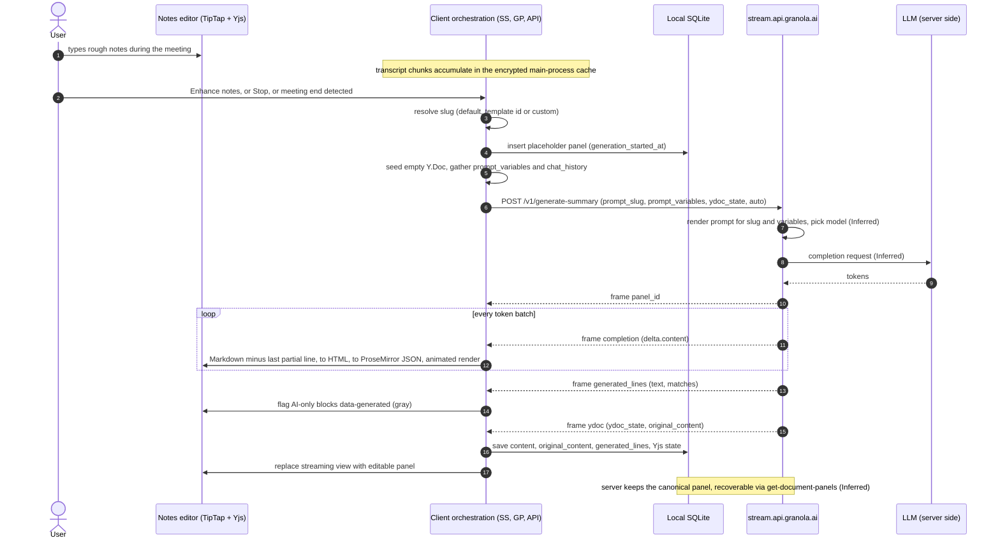
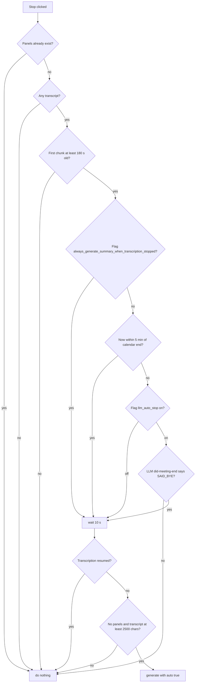
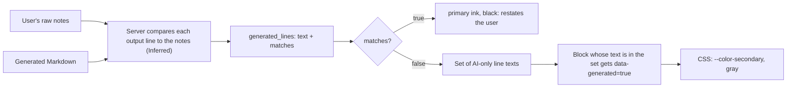
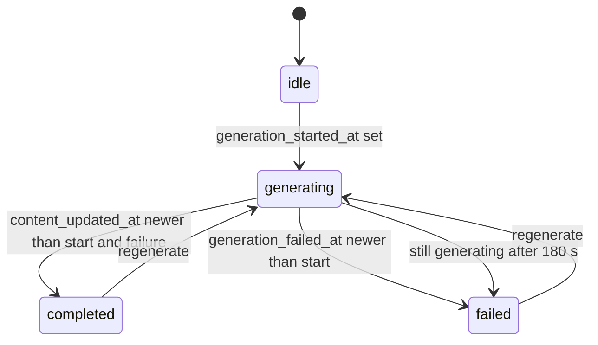

# 03 · AI enhancement: from rough notes and transcript to enhanced notes

This page explains how Granola desktop **7.663.2** turns the notes a user types during a meeting,
plus the transcript, into **enhanced notes**: what triggers a run, what the client sends, where the
prompt lives, how the result streams back and renders, why some lines are gray and others black,
how results are stored and regenerated, and, briefly, chat and the smaller LLM calls around it.

The analysis is static: it reads the minified bundles and captures no network traffic (see
[00 · Method](00-method.md)). Anything that happens on Granola's servers is **Inferred** at best.

## TL;DR

- **The prompt lives on the server.** The client sends a `prompt_slug` (default
  `meeting-summary-consolidated`) and about 40 flat `prompt_variables` to
  `stream.api.granola.ai/v1/generate-summary`; no summary prompt text ships in the app
  **(Observed)**. Prompt rendering and model choice are server-side **(Inferred)**.
- **The inputs are plain text.** Notes are the live editor's HTML converted to Markdown. The
  transcript is `Speaker: text` runs without timestamps (`Me`, `Them`, names, `Speaker A`).
  Attendees become bio sentences, plus date/time/time zone, length booleans and language flags
  **(Observed)**.
- **Three kinds of trigger** **(Observed)**: the "Enhance notes" button; Stop recording (first
  chunk at least 3 min old, calendar end within ±5 min or an LLM `did-meeting-end` check, no resume
  within 10 s, at least 2,500 transcript characters, no panel yet); and automatic runs on meeting-end
  detection, app quit and wake from sleep.
- **Templates are prompt variables.** A template switches the slug to
  `template-summary-consolidated`, renders each section as a `#Heading: instructions` line and adds
  a heading budget (`max_num_headings`, 3 to 8) based on transcript length **(Observed)**. Recipes
  are a different feature: saved slash-command prompts for chat.
- **The response is a delimited chunk stream, not SSE.** JSON frames are separated by
  `-----CHUNK_BOUNDARY-----` and read with `fetch` plus a `ReadableStream`. Frame types:
  `panel_id`, `completion` (OpenAI-style deltas), `generated_lines`, `ydoc`, `error`. A flag-gated
  durable route resumes over SSE by offset **(Observed)**.
- **Progressive rendering.** Each delta re-renders the accumulated Markdown minus its unfinished
  last line (markdown-it, then TipTap `generateJSON`, then an animated read-only view). The final
  server-built **Yjs document** becomes the editable panel **(Observed)**.
- **Gray versus black is a server verdict on each line.** In `generated_lines: [{text, matches}]`,
  lines with `matches` false get `data-generated="true"` and CSS colours them `--color-secondary`
  (gray); everything else stays black **(Observed)**. The server presumably compares output lines to
  the user's notes **(Inferred)**.
- **Each run creates a new panel (tab).** Panels are stored in local SQLite `document_panels` plus a
  `ydocs` row, with the canonical copy on the server **(Inferred)**. Regenerating an edited panel
  asks for confirmation, and the user's own notes are never modified **(Observed)**.
- **Models:** summary requests never name one; chat sends `prompt_config.model` from an enum that
  includes `auto` **(Observed)**.

## Evidence conventions

`SS@86128` means file alias `SS` at character offset 86128: the 0-based JavaScript string index
(UTF-16 code units, as from `indexOf`) of the start of the cited expression. In ASCII-only files this
equals the byte offset; `PRI` and `PP` contain non-ASCII text. Paths are relative to the extracted
`app.asar`. Minified identifiers are named only to help locate code and are specific to this build.

| Alias | Bundle file | Role |
|---|---|---|
| `SS` | `dist-app/assets/startStopTranscribingDocument-Dw_9-FzQ.js` | Summary orchestration: triggers, panels, stream handling |
| `GP` | `dist-app/assets/gatherPromptInputsForDocument-RM0c0C79.js` | Builds prompt variables |
| `API` | `dist-app/assets/api-CCQ12bLQ.js` | HTTP/stream clients, zod schemas, slug lists |
| `TY` | `dist-app/assets/types-yo9U2uQW.js` | Route-name to URL map |
| `PRI` | `dist-app/assets/primary-RB5K54tJ.js` | Main renderer UI |
| `PP` | `dist-app/assets/PortraitPage-u6X9nSDs.js` | Chat UI and send logic |
| `CA` | `dist-app/assets/cache-B8uVNU4r.js` | Feature-flag defaults, markdown helpers, recipe defaults |
| `CS` | `dist-app/assets/cacheStore-B7IWNGUu.js` | Local SQLite schema, Yjs, editor extensions |
| `ES` | `dist-app/assets/entity-schemas-BoWdLbi4.js` | Chat output and citation schemas |
| `TSS` | `dist-app/assets/transcriptionSessionState-DVVZZzFY.js` | Transcript formatter, session helpers |
| `GEM` | `dist-app/assets/getEditorMarkdown-DM5P36g4.js` | Live editor to Markdown |
| `VD` | `dist-app/assets/visibilityDescription-D8WmKwSO.js` | HTML-to-Markdown serializer |
| `PGS` | `dist-app/assets/panelGenerationState-BPO3bayd.js` | Panel generation state |
| `CON` | `dist-app/assets/constants-CD0tZHlZ.js` | Stream delimiter |
| `LNK` | `dist-app/assets/link-DvBrxavF.js` | TipTap core helpers |
| `UCR` | `dist-app/assets/useCombinedRef-CmoZ1f-l.js` | Legacy chat-model remap |
| `UDES` | `dist-app/assets/useDocumentEditorSession-BiVvu_M6.js` | Notes editor session |
| `PREF` | `dist-app/assets/preferencesStore-Biy5VxRw.js` | Developer slug overrides |
| `MDI` | `dist-app/assets/markdown-it-Y_d_XJMo.js` | markdown-it, time constants |
| `SSC` | `dist-app/assets/screenShareContextProcessing-b_GqW55N.js` | Screen-share description step |
| `SNS` | `dist-app/assets/speakerNameSuggestions-CN21N0WQ.js` | Speaker-name suggestions |
| `CSS` | `dist-app/assets/index-Dk_sNDSd.css` | App stylesheet |
| `MAIN` | `dist-electron/main/index.js` | Electron main process |

## 1. Pipeline at a glance

## 2. Triggers

### 2.1 Manual button

- The meeting view shows **"Enhance notes"** or **"Generate notes"** depending on a state flag
  (`PRI@3570055`) **(Observed)**.
- Clicking calls the summary entry point (`wc` in `SS`, imported as `jb`, `PRI@34643`) with the
  document id, the selected or pre-selected "temporary" template, any A/B assignment, and the
  **live editor Markdown** (`PRI@4204818`) **(Observed)**.
- Each run also starts screen-share context preparation in the background without awaiting it
  (`SS@82573`) **(Observed)**.

### 2.2 Stop button, then auto-generation

Stop in the meeting header (`PRI@4172601`) runs the stop handler (`SS@86128`). Thresholds:
`SS@86565` (180 s), `SS@86858` (±300 s), `SS@85950` (10 s; the unit constant is 1,000 ms,
`MDI@433`), `SS@87624` (2,500 characters). The whole flow is **Observed**.

- The 180 s gate measures wall time since the earliest chunk's `start_timestamp`, not the amount of
  speech **(Observed)**.
- With `llm_auto_stop` off, the LLM check returns true without calling a model (`SS@58654`), so any
  Stop after 3 minutes proceeds to the final gate **(Observed)**. The flag's remote rollout is
  **Unknown**.
- The LLM check sends only the **last 100 words** to `did-meeting-end` via `llm-proxy`; whichever of
  `SAID_BYE` / `DID_NOT_SAY_BYE` appears last in the reply wins (`SS@58403`, `SS@58556`)
  **(Observed)**. The parser's error text "Invalid response from Claude" (`SS@58515`) suggests an
  Anthropic model served this slug at some point **(Inferred)**.

### 2.3 Fully automatic paths

- The end-of-meeting function (`SS@88477`) also runs on meeting-end / virtual-camera detection
  (`PRI@4319637`), app quit (`PRI@4902011`) and wake from sleep once the network returns
  (`PRI@4903017`). It re-applies the final gate (`SS@87401`) and re-checks for resumed recording
  between steps **(Observed)**.
- Automatic runs use the temporary template if set, send `auto: true`, then clear the temporary
  template (`SS@87947`, `SS@88312`) **(Observed)**.
- The server can veto automatic runs: HTTP 409 `auto_generation_blocked` on the background route
  (`SS@70514`) or a `failed` event with that code on the durable route (`SS@77453`). The client then
  deletes its placeholder panel **(Observed)**. The veto policy is **Unknown**.
- Behind a flag, a post-meeting run first asks the main process to wait (with a timeout) until the
  transcription session has stopped and final speakers are attributed (`TSS@19313`). It skips the run
  if recording resumed (`SS@80852`), then starts speaker-name suggestions **(Observed)**, so the
  summary sees final rather than provisional speaker labels **(Inferred)**.

### 2.4 Slug resolution and A/B comparisons

- The entry point strips a `v2:` prefix. Any built-in **auto** slug (`notes-centric-*` or
  `meeting-summary-consolidated`, `API@225959`) collapses to `meeting-summary-consolidated`;
  template UUIDs and custom slugs pass through (`SS@82222`, `SS@83144`) **(Observed)**. So the
  `notes-centric-*` variant is picked by the server **(Inferred)**.
- With a summary-comparison assignment, the client creates **two** panels with different prompt
  slugs, action-item slugs and variable overrides. It can blank the user context on one arm
  (`compare_user_context`), randomises which arm comes first 50/50, and suppresses the transcript
  footer (`SS@83383`, `SS@83448`) **(Observed)**.

## 3. The request

### 3.1 Body and headers

The body is assembled at `SS@80974`. Field contents are **Observed** unless marked.

| Field | Content |
|---|---|
| `document_id`, `panel_id`, `panel_title`, `last_viewed_at` | The placeholder panel just created; the title is the template title, else "Summary" (`SS@80290`) |
| `prompt_slug` | Resolved slug (§2.4), after any developer remap (§4.2) |
| `prompt_variables` | The variable dictionary (§3.2) with A/B overrides merged in |
| `chat_history` | Images and screen-share context as chat-style messages (§3.5) |
| `template_slug` | The panel's template id, if any |
| `ydoc_state`, `ydoc_version` | A fresh Y.Doc seed (one empty paragraph in fragment `prosemirror`, `meta.hasSeed`, `SS@79213`), or the panel's existing local Yjs state on restart (`SS@80611`). Version from flag `partytime_ydoc_version` (`CA@44327`) |
| `auto` | True for automatic runs |
| `action_item_extraction_slug` | The A/B arm's action-item prompt; server use **Unknown** |
| `suppress_transcript_footer` | Omits the "Chat with meeting transcript" footer **(Inferred)** |
| `force_user_context` | Forces user/workspace context into the prompt **(Inferred)** |
| `strip_notes_tag` | Always `true` (`SS@81436`); server meaning **Unknown** |

Every call sends `Authorization: Bearer <access token>`, `X-Client-Version`, `X-Granola-Platform`,
`X-Granola-Workspace-Id`, `X-Granola-Device-Id` and `X-Granola-Os-Version` (`API@254681`)
**(Observed)**.

### 3.2 Prompt variables

One gatherer builds the dictionary (`GP@40594`). Meeting titles, Slack summaries and
single-meeting chat reuse it. All rows are **Observed**.

| Variable(s) | Source and format | Evidence |
|---|---|---|
| `notes` | Live editor Markdown, else stored `notes_markdown`, else `notes_plain` | `GP@43323` |
| `headers`, `urls` | Note lines starting with `#` (stripped, comma-joined); URLs in `notes_plain` | `GP@43830` |
| `transcript` | Formatted transcript (§3.4) | `GP@43830` |
| `transcript_labels`, `transcript_labels_just_mic`, `has_room_labels` | Label style: `named`, `speaker_letters`, `me_them`, `just_mic`, `unlabeled` | `TSS@2618` |
| `transcript_length`, `is_short_transcript`, `has_long_user_notes` | Length; under 200 chars; at least 20 non-empty note lines | `GP@43732` |
| `calendar_event_title`, `date`, `time`, `todays_date` | Calendar event, else document title and `created_at`; time includes time zone | `GP@43830` |
| `participants` | `Name <email>` list including the creator; groups noted with member counts | `GP@39918` |
| `my_name`, `my_bio`, `my_company`, `viewer_*` | User profile; the bio is built as English sentences from job title and company | `GP@42111` |
| `their_name`, `their_bio` | Attendees as "A, B and C" with job, company and company descriptions | `GP@43830` |
| `my_colleagues`, `external_attendees`, `external_companies` | Attendees split by the creator's email domain | `GP@43830` |
| `is_multi_language`, `english_only_summary`, `is_british_english` | Transcription language preferences; `en-GB` locale | `GP@16859` |
| `user_dictionary` | The user's custom vocabulary | `GP@43830` |
| `is_ios`, `is_collaborative`, `is_user_type_vc`, `has_speaker_attribution` | Document and user metadata | `GP@43830` |
| `tags` | Note lines containing `@` mention nodes | `GP@16428` |
| `latest_meeting_summary` | This document's latest panel, footer stripped (used by chat) | `GP@45036` |
| `summary_headings`, `first_heading`, `meeting_description`, `max_num_headings`, `template_title` | Template runs only (§6) | `SS@78961` |

Summary generation never includes other meetings **(Observed)**. A meeting-type taxonomy exists
(`API@43870`), but no meeting-type variable is sent; its use is **Unknown**.

### 3.3 Notes and transcript serialisation

- **Notes:** a hand-written DOM walker turns the live editor's HTML into Markdown (`GEM@23080`,
  `VD@62075`). Bold, italic (underscore style, `VD@61603`), links, strikethrough and lists survive;
  block attributes such as timestamps do not **(Observed)**. Stored `notes` is ProseMirror JSON with
  `notes_markdown` / `notes_plain` projections (`CS@108571`) **(Observed)**.
- **Transcript:** chunks are joined into `Label: text …` runs, with a new label only when the speaker
  changes (`TSS@6152`). There are no timestamps and no length cap for summaries **(Observed)**.
  Labels (`TSS@3488`) **(Observed)**: system-audio chunks with a detected participant get that name
  (with a `[Room] ` prefix for room-like names), else `Them`; microphone chunks get the user's
  attributed name, else `Me`; diarized chunks can be `Speaker A`. A word-level formatter with
  reconciled speakers sits behind flag `transcript_word_level_prompts` (`GP@39229`, `CA@56432`).

### 3.4 Images and screen-share context

- Attachments go into `chat_history` as user messages with image parts (`GP@44626`) **(Observed)**.
- Screen-share **descriptions** (not frames) are wrapped in a `<screen_share_context>` block
  (`API@41151`) that labels them machine-generated, untrusted evidence: never instructions, and
  lower priority than the transcript and notes on conflict **(Observed)**.
- A separate vision step produces the descriptions, defaulting to `gemini-3.5-flash` (`SSC@7146`).
  The default is visible but the routing is not **(Inferred)**.

## 4. Server-side prompts and slugs

### 4.1 Slug registry

The client ships **lists of slugs**, not prompt bodies; the same lists appear in main
(`MAIN@459524`) **(Observed)**.

| Group | Slugs (abridged) | Evidence |
|---|---|---|
| Auto summary | `notes-centric-long-input`, `notes-centric-short-input`, `notes-centric-vc-short-input`, `notes-centric-very-short-input`, `meeting-summary-consolidated` | `API@225959` |
| Other summary | `generate-summary`, `template-summary-consolidated`, `new-templates-46-daac`, `collaborative-meeting-summary`, `meeting-summary-consolidated-sonnet-4-6`, … | `API@226118` |
| Utility | `meeting-title`, `did-meeting-end`, `slack-summary`, `view-source-summary`, `chat-thread-title`, `speaker-name-suggestions` | `API@226344` |
| Chat | `chat`, `chat-with-tools`, `live-chat`, `what-did-i-just-miss`, `suggest-follow-up-questions`, `make-me-sound-smart`, `list-action-items`, `multi-chat-claude`, `nextgen-chat`, … | `API@226468` |

- Classification (`SS@61538`) **(Observed)**: a `v2:` prefix or auto-list member is an auto prompt,
  a UUID is a template, anything else is a custom slug.
- The server probably picks among `notes-centric-*` using `has_long_user_notes`,
  `is_short_transcript` and `is_user_type_vc` **(Inferred)**.

### 4.2 Developer overrides and tracing

- A developer preference maps a production slug to a dev slug that replaces `prompt_slug`
  (`PREF@26714`, `API@261551`) **(Observed)**.
- Chat completions carry `braintrustSpanId` / `braintrustTraceExport` (`API@41899`), chat requests
  can set `custom_braintrust_slug` (`PP@740060`), and view-source analytics still use
  `completion_id_vellum` (`PRI@3801355`) **(Observed)**. Prompts are probably versioned and traced in
  Braintrust, with Vellum used earlier **(Inferred)**.

### 4.3 The only prompt text in the client

There is no summary or system prompt anywhere in the renderer or main bundle **(Observed)**. The
prompt bodies that do ship belong to other features:

- a voice-dictation formatter that refuses to follow spoken instructions
  (`dist-app/assets/winWebcamRuntimeProbe-Dqxoac6L.js@129666`);
- a dev-only Slack writing-style extractor
  (`dist-app/assets/slack-writing-style-dev-config-Df4NRdnP.js@558`);
- a DEV-flagged, prioritised action-item extraction sent as a chat message (`PRI@3776134`);
- the `<screen_share_context>` wrapper (§3.4).

## 5. Endpoints

Routes resolve through one map in `TY`; offsets point at each route's key **(Observed)**.

| Purpose | Route | Evidence |
|---|---|---|
| Enhance, streamed ("background") | `POST https://stream.api.granola.ai/v1/generate-summary` | `TY@26714`, `API@265965` |
| Enhance, durable (flag `durable_summary_generation`) | `POST …/v1/trigger-summary-generation`, returning a `streamUrl` on `/v1/read-durable-stream` | `TY@53149`, `TY@44489`, `API@264180`, `CA@32593` |
| Panel CRUD and recovery | `get-document-panels` (with `include_ydoc_state`), `create-document-panel`, `update-document-panel` | `TY@29571`, `TY@21756`, `TY@54500` |
| One-shot LLM | `POST https://api.granola.ai/v1/llm-proxy` | `TY@40780`, `API@261551` |
| Streamed small LLM | `POST https://stream.api.granola.ai/v1/llm-proxy-stream` | `TY@40830`, `API@263077` |
| Chat | `POST https://stream.api.granola.ai/v1/chat-with-documents` (`-web` variant) | `TY@19833`, `API@277550` |
| Chat models, citations | `get-chat-models`, `get-chat-citation` | `TY@27897`, `TY@27831` |
| Templates | `get-panel-templates`, `create-panel-template`, `update-panel-template` | `TY@33087`, `TY@21920`, `TY@55279` |
| Recipes | `get-recipes`, `upsert-recipe`, `delete-recipe`, `track-recipe-usage`, `update-user-saved-recipe` | `TY@33912`, `TY@56723` |
| Experiments, feedback | `get-summary-comparison-assignment`, `get-summary-comparison-experiment`, `submit-summary-feedback` | `TY@34804`, `TY@51621` |
| Not traced | `generate-follow-up-email(-stream)`, `regenerate-action-items(-preview-stream)`, `llm-process-attachments`, `trigger-folder-summary`, `pre-meeting-brief`, `granny-agent` | `TY@26441`, `TY@45123` |

Every RPC is a JSON `POST` (`API@256269`) and responses carry `apigw-requestid` (`API@256877`)
**(Observed)**, which points to AWS API Gateway **(Inferred)**. No OpenAI, Anthropic, Google,
Bedrock, Groq or xAI host appears in the renderer, main or preload bundles **(Observed)**.

## 6. Templates

### 6.1 Schema

`panel_templates` rows use generated zod Row/Insert/Update schemas (`API@54031`) **(Observed)**:

| Field | Meaning |
|---|---|
| `id` | UUID, which doubles as the "slug" passed to generation |
| `title`, `description` | Template name; description of the meeting type |
| `sections` | JSON array of `{heading, section_description}` |
| `is_granola`, `owner_id`, `shared_with`, `copied_from` | Built-in flag, ownership, sharing, copy lineage |
| `category`, `color`, `symbol`, `icon`, `chat_suggestions`, `user_types` | Presentation, suggested chat prompts, target users |
| `created_at`, `updated_at`, `deleted_at` | Timestamps (soft delete) |

- The section editor labels the fields "Section title" and "Instructions for Granola…"
  (`PRI@3590362`). Built-ins are read-only; "Copy" makes a user-owned `<title> (Copy)` with
  `is_granola` false (`PRI@3598322`) **(Observed)**.
- Built-in template names and section text are **Unknown**: they arrive from `get-panel-templates`
  at runtime. Bundle strings like "User interviews" are onboarding folder presets (`API@239151`).

### 6.2 How a template shapes the prompt

For a template UUID, the client looks up the cached template, switches `prompt_slug` to
`template-summary-consolidated` (`SS@78157`) and adds five variables (`SS@78961`) **(Observed)**:

- `summary_headings`: one `#<heading>: <section_description>` line per section, newline-joined;
- `first_heading`: `#<first heading>`;
- `meeting_description` and `template_title`: the template's description and title;
- `max_num_headings`: the heading budget, from the formatted transcript length (`SS@78808`):

| Transcript length (chars) | `max_num_headings` |
|---|---|
| < 8,000 | 4 |
| 8,000 to 19,999 | 5 |
| 20,000 to 79,999 | ⌊length / 10,000⌋ + 1, so 3 to 8 |
| ≥ 80,000 | 8 |

The bands are not monotonic: at 20,000 characters the budget drops from 5 to 3 and only returns to
5 at 40,000 **(Observed)**. Whether that is intended or clamped server-side is **Unknown**.

Headings can carry a `templateHeading` attribute, rendered as `data-template-heading`
(`CS@974041`) **(Observed)**, presumably set by the server on headings from template sections
**(Inferred)**.

## 7. Recipes versus templates

| | Panel template | Recipe |
|---|---|---|
| Purpose | Shapes the **enhanced notes** | A saved **chat** prompt invoked as `/slug` |
| Core fields | `title`, `description`, `sections[]` | `slug`, `config.instructions`, `config.examples[]`, `config.generate_artifact`, optional `config.model`, `config.additional_contexts` (web search, related meetings, upcoming events, transcripts) |
| Scope | `owner_id`, `shared_with`, `is_granola` | `visibility` (`public`, `workspace`, `private`), `publisher_slug` (`granola` for built-ins), `allowed_recipe_views` |
| Runs through | `generate-summary` with `template-summary-consolidated` | `chat-with-documents` |
| Evidence | `API@54031`, `SS@78157` | `CA@139245`, `PP@559443` |

- Recipe contexts are `live-meeting`, `meeting`, `upcoming-meeting` and `multi-meeting`
  (`CA@140782`); default recipes come from flags (`list-recent-todos` for My Notes, `catch-me-up`
  for team spaces, `CA@41870`, `CA@52168`) **(Observed)**.
- On send, `/slug` becomes `/<recipe uuid>` and the recipe's model and context toggles are applied
  (`PP@734037`, `PP@734106`) **(Observed)**; the server expands the UUID into instructions
  **(Inferred)**.

## 8. Model selection

- **Summaries:** no model field is sent **(Observed)**. Models are bound to slugs server-side and
  A/B tested through variants such as `meeting-summary-consolidated-sonnet-4-6` (`API@226118`) and
  flag `summary_gen_sonnet_4_6` (`CA@51037`) **(Inferred)**.
- **Chat:** `prompt_config.model` comes from an enum (`API@223064`, `auto` added at `API@223905`),
  for example `auto`, `claude-5-5-sonnet`, `claude-opus-5-5`, `gpt-6-sol`,
  `gemini-3-1-pro-thinking`, `grok-4-7` and `kimi-k3`. Legacy ids are remapped (`UCR@80801`),
  groups and defaults come from `get-chat-models`, meeting and global chat keep separate selections
  (`PP@590531`), and flag `chat_model_override` can force a model (`CA@28659`) **(Observed)**.
- **Providers:** a tool-call replay schema names `anthropic`, `vertex-anthropic`, `bedrock`,
  `openai`, `xai`, `google`, `vertex-google` and `baseten` (`ES@9921`) **(Observed)**; routing is
  server-side **(Inferred)**.
- **Reasoning:** `llm-proxy-stream` deltas may carry `delta.reasoning` (`API@263669`)
  **(Observed)**, so some slugs use reasoning models **(Inferred)**.

## 9. Streaming transport and rendering

### 9.1 Framing and event types

The delimiter constant is `-----CHUNK_BOUNDARY-----` (`CON@1165`). Readers decode UTF-8, split on
it, carry the trailing partial piece into the next read and parse each complete piece as JSON, over
`fetch` with a `ReadableStream` rather than `EventSource`. The same framing serves
`generate-summary` (`API@265965`), `llm-proxy-stream` and chat **(Observed)**. Events form a zod
union on `type` (`API@246886`), dispatched at `API@266922` **(Observed)**:

| `type` | Payload | Client action |
|---|---|---|
| `panel_id` | `panel_id` (uuid) | Server accepted the panel; recovery bookkeeping starts |
| `completion` | `choices[].delta.content` (OpenAI style) | Append to accumulated text, re-render (§9.4) |
| `generated_lines` | `[{text, matches?}]` | Store the provenance set, broadcast to the panel view (§10) |
| `ydoc` | `ydoc_state`, `ydoc_version`, `original_content` | Final document as Yjs state plus original output |
| `error` | `message` | Mark the panel failed |
| `completed` (durable only) | `result{panelId, summaryTextCharacterCount}` | Check id and text length, then save (`SS@77010`) |
| `failed` (durable only) | `code` | Delete the placeholder on `auto_generation_blocked`, else fail |

### 9.2 Timeouts, errors and recovery

All rows are **Observed**.

| Condition | Behaviour | Evidence |
|---|---|---|
| No headers after 15 s | Starts recovery: polls the server's panel about every 5 s until completed, failed or watchdog expiry | `API@265953`, `SS@66019` |
| Stream open more than 185 s | Request times out (180 s watchdog plus 5 s) | `SS@66019`, `PGS@382` |
| 409 `generation_already_in_progress` | Polls for the server's result | `SS@70716` |
| 409 `auto_generation_blocked` | Deletes the placeholder panel | `SS@70514` |
| 404 "Document not found" | Recreates the document server-side, retries once | `SS@70210` |
| Stream error after open, before `panel_id` | Switches to recovery polling | `SS@71094` |
| Server panel still idle 30 s into recovery | Re-sends once, then gives up (`stream-recovery-exhausted`) | `SS@67212`, `SS@68173` |
| Empty final text | Panel failed (`empty-response`) | `SS@63724` |

### 9.3 The durable route

Behind `durable_summary_generation` (route switch at `SS@80519`) **(Observed)**:

- The pending attempt is saved in `localStorage` as `summary-stream:<userId>:<panelId>` with a
  14-minute expiry (`SS@73198`, `SS@74390`).
- The trigger sends an `Idempotency-Key` (the attempt UUID) and returns `{streamUrl}`
  (`API@264180`).
- An Electric "Durable Streams" client reads it from offset `-1` in SSE live mode with JSON
  parsing and 1, 2, 4, 8, 16 s backoff (`API@264584`, `API@264938`), using the `Stream-Next-Offset`,
  `Stream-Cursor` and `Stream-Up-To-Date` headers (`API@3949`).

This lets a reloaded, woken or crashed renderer re-attach to a running generation **(Inferred)**.

### 9.4 Rendering while streaming

On each `completion` frame **(Observed)**:

1. Split the accumulated text into lines and **drop the last**, which may be incomplete, so a
   half-written `**` or list marker never flickers (`SS@63302`).
2. Render the rest with markdown-it (HTML, linkify, typographer, task lists; `CA@135094`).
3. Dispatch an event with the panel id, the HTML and the current generated-lines set.
4. Convert the HTML to ProseMirror JSON with TipTap's schema parser (`PRI@3819225`, `LNK@228288`).
5. Paint with an animated read-only node renderer that auto-scrolls (`PRI@3777680`).

The `ydoc` frame is decoded into a Y.Doc whose `prosemirror` fragment becomes the panel's
ProseMirror JSON via y-prosemirror (`SS@63118`) **(Observed)**. Because the server builds the Yjs
document, the finished panel can join realtime collaboration immediately **(Inferred)**. The schema
is standard TipTap plus `generatedLines`, `templateHeadingAttribute`, `uniqueID` and
`collaboration`; there is no "AI" mark **(Observed)**.

## 10. Provenance: gray versus black

- The client keeps the HTML-unescaped texts of lines whose `matches` is false (`PRI@3824778`)
  **(Observed)**.
- **Streaming view:** headings, paragraphs and task items whose concatenated text is in the set get
  `data-generated` true (`PRI@3783392`) **(Observed)**.
- **Editable panel:** the `generatedLines` TipTap extension holds the set in plugin state, seeded
  from stored lines and replaceable by transaction (`PRI@3795459`). Headings get the attribute via
  decorations comparing trimmed `textContent` (`PRI@3796135`); paragraphs via a node view
  **(Observed)**.
- **Styling:** one rule colours `[data-generated=true]` in the static editor, panel editor and
  generating view with `var(--color-secondary)` (`CSS@517108`) **(Observed)**.
- **Consequences (Inferred):** provenance is keyed on **text equality**, not node identity, so an
  edited gray line stops matching and turns black ("now mine"). Collaborators see the same colours
  because `generated_lines` is stored with the panel. "View source" (§13) is offered only on
  generated paragraphs, whose node view receives an `isGenerated` prop.
- How `matches` is computed (exact, normalised or fuzzy) is **Unknown**.

## 11. Persistence and regeneration

### 11.1 Storage and completion save

Local SQLite `document_panels` is declared with drizzle (`CS@107358`) **(Observed)**:

| Column group | Columns |
|---|---|
| Identity | `id`, `document_id`, `title`, `template_slug` |
| Content | `content` (ProseMirror JSON), `original_content` (server's original output), `generated_lines` (JSON), `suggested_questions` |
| Generation | `generation_started_at`, `generation_failed_at`, `content_updated_at` |
| Collaboration | `ydoc_version`; Yjs state in `ydocs(doc_id, data)` keyed by panel id, `summary` and version (`CS@1006636`, `CS@1006839`) |
| Misc | `has_speaker_attribution`, `user_feedback`, `last_viewed_at`, `deleted_at`, `affinity_note_id` |

- On completion the client writes `content`, `original_content`, `generated_lines` and
  `content_updated_at`, clears `generation_failed_at` and stores the Y.Doc (`SS@63425`). An FTS5
  trigram index (`document_panels_fts`) makes panels searchable offline **(Observed)**.
- The server creates and stores the panel during generation (it returns `panel_id` and later serves
  the panel with Yjs state from `get-document-panels`), so the local row is a cache and recovery
  path **(Inferred)**.

### 11.2 Generation state

State is derived purely from three timestamps (`PGS@382`) **(Observed)**:

### 11.3 Regenerate and switching templates

- Each run is announced as `new_tab_created` and creates a panel with its own `template_slug`
  (`SS@82247`) **(Observed)**, so switching templates adds a tab rather than overwriting
  **(Inferred)**.
- Before re-running a panel, the client serialises its content to Markdown and compares it with
  `original_content` (`PRI@3686156`, `PRI@3686521`); if edited, a "Regenerate notes?" dialog warns
  that edits will be replaced (`PRI@3687170`) **(Observed)**.
- Enhancement **never modifies the user's own notes**; only chat's "edit with AI" tools do (§12)
  **(Observed)**.
- A "Chat with meeting transcript: …" footer counts as generated and is stripped when a summary is
  reused as context (`PRI@3806732`, `GP@45036`) **(Observed)**; the server appends it unless
  `suppress_transcript_footer` is set **(Inferred)**. A DEV flag can insert an "Action Items" task
  list at the top of a panel (`PRI@3820160`) **(Observed)**.

## 12. Chat / Ask Granola (brief)

- **Transport:** `POST /v1/chat-with-documents`, same framing, 60 s timeout (15 s in some modes),
  2 retries (`API@277550`) **(Observed)**.
- **Request:** `thread_id`, `chat_history`, `document_ids` / `list_id` / `chat_context`,
  `transcripts` / `web_search` / `edit_with_ai` toggles, `attachment_ids`, `user_timezone` and
  `prompt_config{response_style, custom_braintrust_slug, input_values, model}` (`PP@741734`,
  `PP@740060`). Single-meeting chat sends the §3.2 dictionary as `input_values`, optionally with
  `user_selected_text` **(Observed)**.
- **Chunks** (`API@41899`): `text_delta`, `context_sources_delta`, `context_limit_reached`,
  `outputs` / `output_delta` (text, `tool_call`, `reasoning`, `draft_preview`), `stream_completed`
  and `error` **(Observed)**.
- **Citations:** `text_with_citations` answers carry per-line citations with a source type
  (transcript, summary, pre-meeting brief, email, calendar, web) and a quote (`ES@37298`,
  `ES@33350`), resolved via `get-chat-citation` **(Observed)**.
- **Agentic edits:** tools such as `rewriteMeetingNotes`, `editBlock` and `createBlock`
  (`GEM@8432`) highlight and patch the open notes (`PP@743040`) **(Observed)**. The server chooses
  the chat slug and retrieves across meetings (Turbopuffer) **(Inferred)**.

## 13. Utility LLM calls

All **Observed**. One-shot calls use `llm-proxy` and read `choices[0].message.content`.

| Feature | Slug, route | Inputs and post-processing | Evidence |
|---|---|---|---|
| Meeting title | `meeting-title`, `llm-proxy` | Full gathered variables; output trimmed, rejected if it has a newline, clamped to 100 chars | `PRI@4062061` |
| Did the meeting end? | `did-meeting-end`, `llm-proxy` | Last 100 words; last of `SAID_BYE` / `DID_NOT_SAY_BYE` wins | `SS@58654` |
| View source | `view-source-summary`, `llm-proxy-stream` | The note line, its `timestamp` and transcript windows (about 1,800 / 200 / 3,000 chars). Quotes link and scroll to the transcript; 😭 means "no relevant context" | `PRI@3801148`, `PRI@3799695`, `PRI@3801594` |
| Slack summary | `slack-summary`, `llm-proxy` | Gathered variables plus Slack fields | `PRI@3663511` |
| Speaker names | `speaker-name-suggestions`, `llm-proxy` | One `input` string; JSON name mappings with evidence quotes, then gated | `SNS@18932` |
| Chat thread title | `chat-thread-title`, `llm-proxy` | Thread variables | `API@261436` |

View source relies on the `timestamp` the editor stamps on typed or pasted paragraphs (pastes also
get `do-not-annotate`, `UDES@90661`), so note timestamps reach an LLM only on demand, never in the
summary prompt **(Observed)**.

## 14. Unknowns

- Prompt bodies, the model per slug, and how `notes-centric-*` variants are chosen.
- How `generated_lines.matches` is computed (exact, normalised or fuzzy; per line or per block).
- The exact `ydoc_state` encoding (it looks like a base64 Yjs update; not decoded).
- Built-in template and recipe text, which arrives at runtime.
- What the server does with `strip_notes_tag`, `action_item_extraction_slug` and
  `force_user_context`, and how user/workspace context is injected (flags such as
  `include_user_context_in_summary` exist, `CA@36674`).
- The `auto_generation_blocked` policy and the remote rollout of `llm_auto_stop`,
  `durable_summary_generation` and the summary A/B flags.

## 15. Implications for a re-implementation

- **Server-owned prompts keyed by slug.** The client sends `{slug, variables, attachments}`, so
  wording, model routing and A/B arms change without a release; a slug-to-dev-slug override gives
  prompt engineers a safe test path.
- **Typed variables, not a pre-built prompt.** Notes as Markdown, speaker runs without timestamps,
  bio sentences, date/time with time zone, and cheap booleans (`is_short_transcript`,
  `has_long_user_notes`) let the server pick a variant for sparse or rich inputs.
- **Templates as data with a heading budget.** `#Heading: instructions` lines plus a budget scaled
  to transcript length keep short meetings from being padded; make the budget monotonic, unlike the
  5-to-3 drop at 20,000 characters.
- **Untrusted-data framing everywhere.** Granola frames only screen-share text this way;
  transcripts and attachments deserve the same, because participants can say anything.
- **Provenance from the generator.** Per-line "derived from the user's notes?" flags, applied as a
  node attribute or decoration (not a mark) and stored with the panel. Decide whether an edit should
  flip a line to "mine", as Granola's text-equality approach does.
- **Resumable, idempotent generation.** Typed frames over a delimited stream are simple; an
  offset-addressed stream with an idempotency key survives reloads and sleep, and a timestamp state
  machine with a watchdog lets stuck panels heal.
- **Safe streaming Markdown.** Drop the incomplete last line before parsing, and convert into the
  editor schema instead of injecting HTML.
- **Never overwrite user work.** Write output to a separate panel, keep `original_content` to detect
  edits, confirm before regenerating, and gate automatic runs on clear thresholds.
