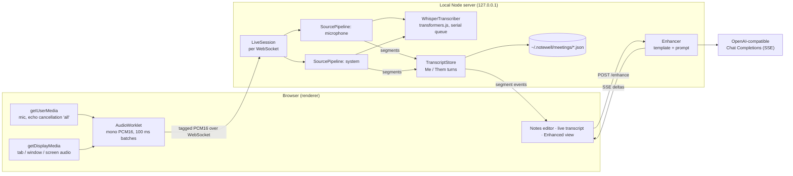

# 04 · notewell: an open re-implementation

[notewell](../notewell/) is an original, local-first implementation of the two features this
teardown focuses on: **transcribing a meeting from microphone and system audio** and **turning
rough notes plus the transcript into enhanced notes**. It follows the shape of Granola's design
where that shape is a good idea, and deliberately differs where Granola's choices depend on its
cloud backend. None of Granola's code is used.

Chosen constraints for this build:

- TypeScript core with a local web UI (testable anywhere; the core can move into Electron later).
- **Local Whisper only** for speech recognition, so audio never leaves the machine.
- **OpenAI** for note enhancement, behind a small provider interface (any OpenAI-compatible
  endpoint works: Azure, Groq, Ollama, LM Studio).

## Architecture

Each `SourcePipeline` runs: resample to 16 kHz (windowed sinc) → 32 ms frames → Silero VAD v5 →
utterance segmenter → Whisper → hallucination filter → transcript segment. Interim results
re-transcribe the open utterance about every 2 s under the same segment id, and the final text
replaces them.

## Granola → notewell mapping

| Concern | Granola (see docs 02/03) | notewell | Why the difference |
|---|---|---|---|
| Mic capture | Renderer `getUserMedia`, Chromium echo cancellation `{ideal:'all'}` | Same approach and constraint | Proven, and needs no native code |
| System audio | `getDisplayMedia`; main process answers with a loopback source (Core Audio tap on macOS 14+, ScreenCaptureKit on 13) | `getDisplayMedia`; the user picks a tab, window or screen with audio | A browser can't auto-grant loopback; an Electron port could do what Granola does |
| Framing | AudioWorklet resamples to 16 kHz, 100 ms PCM16 batches to main | Worklet sends native-rate PCM16 in 100 ms batches; the server resamples | Some browsers won't run a 16 kHz AudioContext beside a 48 kHz device; server-side band-limited resampling is also higher quality |
| Speaker split | Mic = "Me", system = "Them", separate provider streams; optional diarization | Same Me/Them split from the capture path, separate pipelines | Diarization is on the roadmap |
| ASR | Cloud first (Deepgram nova-3 by default; AssemblyAI, Meta, relay by flag); on-device Parakeet/Whisper is an English-only opt-in | Local Whisper (transformers.js, `whisper-base` q8 by default) | Privacy requirement for this build |
| Segmentation | Local ASR path uses an energy gate: 256 ms pre-roll, 800 ms silence, 25 s cap | Silero VAD with hysteresis: 300 ms pre-roll, 600 ms silence, 200 ms post-roll, 15 s cap | Silero is more robust to keyboard and room noise; shorter caps make live text appear sooner |
| Hallucinations | whisper.cpp path checks length | Non-speech tag, stock-phrase, repetition-loop and characters-per-second filters | Whisper on VAD clips still invents "Thank you." |
| Transcript model | `{id, document_id, start/end_timestamp, text, source, is_final, speaker…}` | `{id, source, startMs, endMs, text, final}` | Same idea, local timeline |
| Storage | Transcript in encrypted `cache-v6.json.enc`, uploaded every 60 s; documents in encrypted SQLite | One JSON file per meeting under `~/.notewell` | Small and inspectable; encryption is a roadmap item |
| Prompt location | Server-side, keyed by slug, with about 40 variables | In-process prompt builder (`core/enhance/prompt.ts`) | No backend; the builder is a pure function and easy to swap |
| Prompt inputs | Notes as Markdown, transcript as `Me:`/`Them:` runs without timestamps, attendees and bios, date/time with time zone, template sections as `#Heading: instructions`, heading budget scaled by transcript length | Notes, context, speaker runs without timestamps, date/time with time zone, template sections, a topic budget scaled by length, a short-transcript hint | Same signals that matter, own wording |
| Untrusted input | Screen-share context is framed as untrusted data | All meeting data is framed as data, never instructions | Meeting participants can say anything |
| Triggers | Button; on stop when the transcript is ≥ 3 min old and ≥ 2,500 chars; automatic on meeting end | Button; automatic after Stop when the final transcript is ≥ 2,500 chars and nothing is enhanced yet | No calendar integration yet |
| Streaming | JSON events split by a boundary string over a fetch stream; the final doc arrives as Yjs | SSE `delta` / `done` / `error` events | Standard, works through `parseSse` on both ends |
| Provenance (gray vs black) | Server returns `generated_lines[{text, matches}]`; unmatched blocks get `data-generated` and a secondary colour | Client-side token overlap between each output block and the user's lines; matches render in ink, the rest in gray | Same UX without a server; could move server-side and be persisted |
| Models | Server-side routing per slug; chat offers a model picker | `NOTEWELL_OPENAI_MODEL` / `--llm-model`, any OpenAI-compatible endpoint | User-controlled |

## Security posture

- The server binds to `127.0.0.1` and accepts only loopback `Host` headers and loopback or absent
  `Origin`s, both on HTTP and on the WebSocket upgrade. A web page you visit can't reach your
  meetings or microphone stream through DNS rebinding or cross-site requests.
- Meeting ids are UUIDs and are validated before use as filenames; static file serving is confined
  to its root directory.
- Model output is rendered with DOM APIs (`textContent`), never `innerHTML`, and only `http(s)`
  links are allowed.
- The OpenAI key is read from the environment on the server and never sent to the browser.

## Verification performed

- **Unit and integration tests (51):** resampler accuracy and chunk-invariance, WAV codec, VAD
  segmenter state machine, pipeline interim/final ids, transcript store, meeting store concurrency
  and path safety, SSE parsing, OpenAI streaming client, prompt builder, enhancer, and the HTTP/WS
  server (CRUD, Host/Origin rejection, live PCM → segments → persistence, SSE enhancement against a
  mock OpenAI endpoint).
- **Live model test** (`npm run test:live`): Silero VAD and Whisper on a public-domain speech clip.
  It produced "And so my fellow Americans / Ask not! / what your country can do for you, ask what
  you can do for your country."
- **Browser end-to-end run:** headless Chromium with a WAV file as the fake microphone, driven
  through the real UI. Audio went through the AudioWorklet and the server to Whisper, and the live
  transcript appeared in the panel. This run found and fixed a worklet bug (a transferred buffer was
  re-used after detaching), which unit tests couldn't catch.

## Roadmap

- **Native system audio.** An Electron shell whose main process answers `getDisplayMedia` with a
  loopback source (Granola's approach), so there's no share picker.
- **Diarization** on the system stream (for example sherpa-onnx speaker embeddings) to replace
  "Them" with Speaker A/B, and voice-print matching for in-person meetings.
- **Glossary biasing** from meeting context: names and jargon as a decoder prompt or hotwords.
- **Encryption at rest** for meetings, with a key in the OS keychain.
- **Server-side provenance** stored with the enhanced notes, plus edit detection before regenerating.
- **Calendar-aware triggers** and attendee context.
